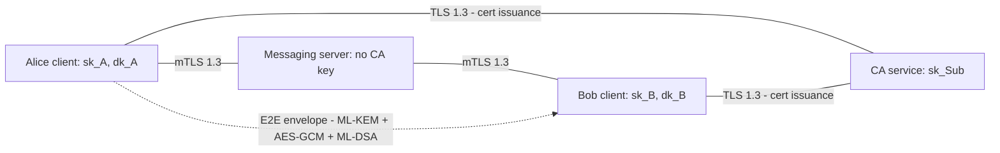
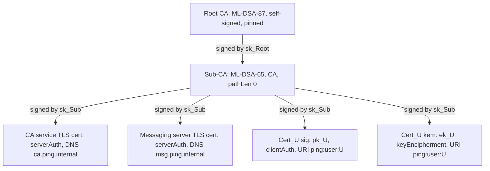
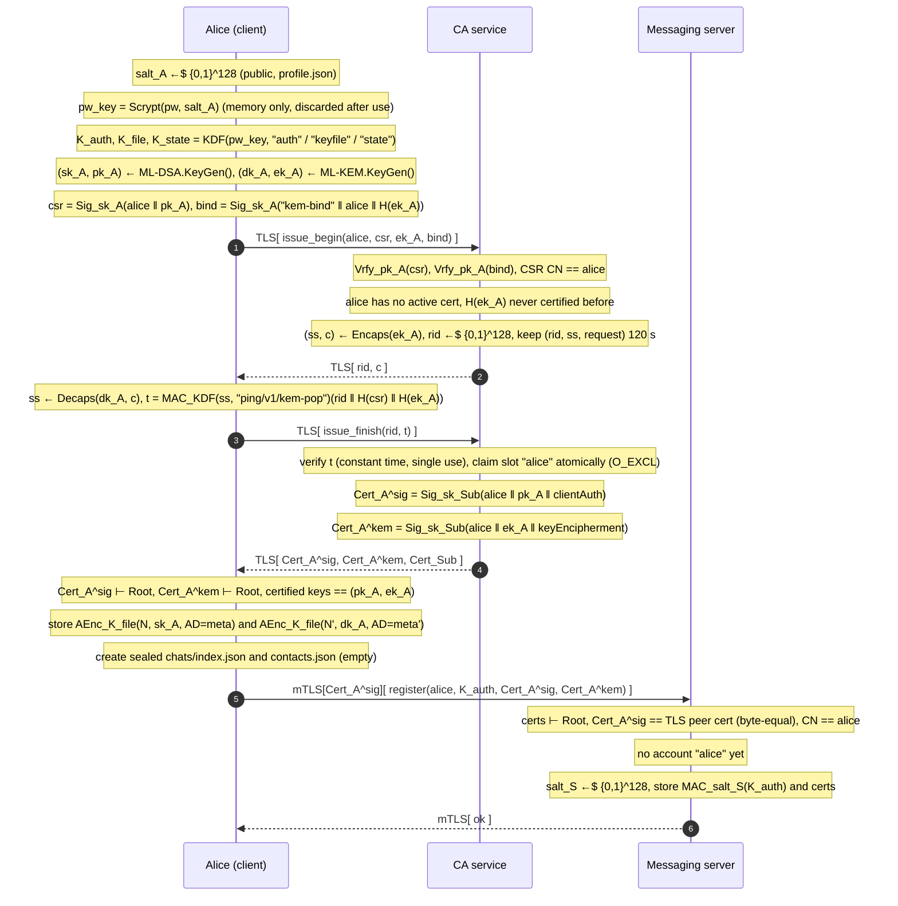
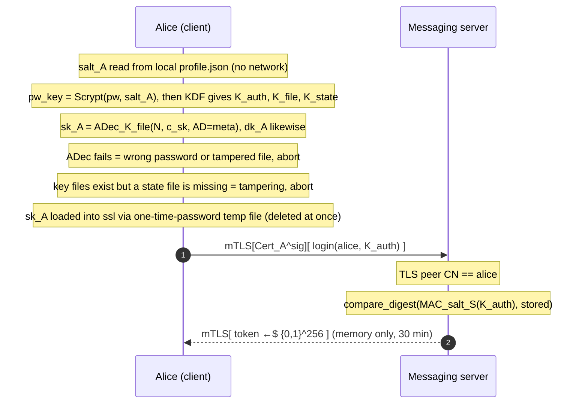

# Ping: PQC secure messenger (UC3M crypto project)

## Context
This is the UC3M cryptography group project, and the repo is empty (`main.py` hello-world, `pyproject.toml`, Python 3.14, uv). The brief (`Cryptography-Project-Goals-Assessment.pdf`) asks for:
- multiple users, sign-up and login
- authenticated encryption of stored data
- digital signatures
- a mini-PKI (Root CA → Sub-CA) that certifies every user or system public key
- a report and an in-person defense

Points: PKI 1.0, report 1.0, AE 0.6, signatures 0.6, key management 0.5, auth 0.3.

Decisions so far:
- A client–server messenger over **TLS 1.3 with mutual TLS (mTLS)**.
- A transport abstraction so the app can fall back to local, in-process mode. Local mode is a **single-operator** mode: one person controls every role on one machine. It runs the same client crypto and the same envelope checks, but it does not demonstrate the separation between the CA and the messaging server (see "Backends").
- The `cryptography` library for all crypto.
- **Post-quantum algorithms for every signature and every E2E key encapsulation.** The TLS key exchange is hybrid X25519MLKEM768 (classical + PQ, defense in depth). It is not "pure" PQ, and the report says so.
- A **separate ML-KEM certificate** per user, with a real, challenge-based proof of possession of the KEM key.
- Authenticated encryption for private keys and client state at rest.
- **Chat history lives on the client**, one sealed file per conversation. The server only holds envelopes until the recipient acks them. The sealed chats are the app's main "user data under authenticated encryption".
- **Close the server man-in-the-middle (MITM) gap:** the messaging server must not be able to issue certificates.

Already confirmed in the scratchpad probe (cryptography 50.0.2, ssl on OpenSSL 3.5.7):
- ML-DSA CA, CSR and leaf certificates build correctly.
- `x509.verification` ClientVerifier accepts a URI SAN.
- ML-KEM public keys can go in certificates.
- An mTLS handshake with ML-DSA certificates on both sides succeeds.

Still to probe before relying on it:
- Verifying an ML-KEM leaf (keyEncipherment, no clientAuth EKU) with `x509.verification` and a custom `ExtensionPolicy`. Fallback: `cert.verify_directly_issued_by(issuer)` for each link, plus manual validity, BasicConstraints, KeyUsage and EKU checks in `pki.verify_cert`.
- `ssl.load_cert_chain` with an encrypted PKCS#8 ML-DSA key.
- ML-DSA-signed CRLs in both `cryptography` and the `ssl` module's OpenSSL (stage 2).
- Whether Python 3.14's `ssl` can report or configure the key-exchange group. If not, rely on the OpenSSL ≥ 3.5 assertion below plus the `openssl s_client` check.

Already done: `uv add cryptography`. Nothing will be committed (global rule).

## Algorithm suite
| Purpose | Algorithm |
|---|---|
| Root CA | ML-DSA-87 |
| Sub-CA, CA-service TLS, messaging-server TLS, user signing/mTLS | ML-DSA-65 |
| User encryption | ML-KEM-768 (own certificate, KeyUsage keyEncipherment only) |
| KEM proof of possession | CA encapsulates to `ek`; client answers with HMAC-SHA256 under a key derived from `ss` |
| Message body | AES-256-GCM with a random 256-bit content key (CEK), plus key commitment `HMAC-SHA256(CEK, "ping/v1/commit")` |
| CEK wrapping | ML-KEM-768 encapsulate → HKDF-SHA256 → AES-256-GCM (recipient only; the sender keeps their own copy in local chat history) |
| Signatures | ML-DSA-65, encrypt-then-sign |
| Passwords | Client Scrypt → HKDF split; server stores salted HMAC-SHA256 of the 256-bit `auth_key` |
| Private keys and client state at rest | Own AEAD container (AES-256-GCM, metadata as AAD), file mode 0600 |
| Transport | TLS 1.3 only, hybrid X25519MLKEM768 (OpenSSL 3.5 default). Every command first asserts OpenSSL ≥ 3.5 for both `ssl` and `cryptography` |

## Architecture: three separate trust domains
```
                 ┌───────────── Root CA (key used only by `ping init-pki` / `ping ca sign-server`)
                 │ signs
   ┌─────────────▼────────────┐   issue certs (TLS)   ┌───────────┐
   │ CA service `ping ca serve`│◀─────────────────────│           │
   │ holds Sub-CA key         │   get_certs / get_crl │  client   │
   │ ca_service.py + ca store │──────────────────────▶│ (per user)│
   └──────────────────────────┘                       │           │
   ┌──────────────────────────┐   mTLS (user cert)    │           │
   │ Messaging server         │◀─────────────────────▶│           │
   │ `ping server serve`      │  register/login/send/ └───────────┘
   │ NO CA key, only Root cert│  inbox/ack/get_certs
   └──────────────────────────┘
```
- **Two services, two processes, two homes:**
  - `ca_service.py`, run as `ping ca serve`. Sub-CA key in `keys/pki/sub/`, issuance records in `data/ca/`.
  - `service.py` (messaging), run as `ping server serve`, data in `data/server/`.
  - Both run on a generic `tlsserver.py` (ssl + ThreadingTCPServer + `protocol.py` framing).
- **Distinct service identities.** Each service has its own TLS certificate from the Sub-CA, with its own DNS SAN: `ca.ping.internal` (CN `ping-ca`) and `msg.ping.internal` (CN `ping-server`). Clients connect to `127.0.0.1:<port>` but pass the expected name as `server_hostname`. That way the CA's key can't pose as the messaging server, or the other way round. User certificates carry only a URI SAN `ping:user:<name>` and clientAuth, so they can never pass as a service. The username regex has no `-` or `.`, so a username can never collide with a service CN.
- **Each service generates its own TLS key.** `ping server init` creates the server key and a CSR in the server home, and `ping ca sign-server` (offline, needs the Sub-CA passphrase) signs it. The CA-service TLS key is generated in the CA home by `init-pki`. No private key ever moves between homes.
- **Backends:**
  - `RemoteBackend` holds two TLS connections (CA and messaging). This is the real deployment, and the only mode in which the trust-separation claims hold.
  - `LocalBackend` holds a `CAService` and a `MessagingService` as separate objects over a shared home. They share no references, and only the CA object ever loads the Sub-CA key. It loads the key lazily, only when `issue` is called, so a local client that only logs in and chats never needs the Sub-CA passphrase.
  - **Local mode trust model (stated in the report):** whoever runs a local client during sign-up holds the Sub-CA key in that process and can read `data/server/` directly. That's acceptable only because one operator controls every role. The MITM table below applies to remote mode.
  - **Local mode across processes:** several local clients (Alice and Bob in two terminals) share `data/`. Every read-modify-write on shared state (issuance slot, KEM index, per-recipient sequence counter, account records) takes an `fcntl.flock` on a lock file next to it. Name claims use `O_CREAT|O_EXCL`, and every write is atomic via `os.replace`.
  - `--mode remote|local`. Client crypto and the envelope pipeline are the same in both modes.
- **mTLS policy, messaging server:**
  - `CERT_REQUIRED` for every request, including `register`. The user already has certificates from the CA by then.
  - The server checks that the client certificate's CN equals the request's username or the session's username.
  - The CRL is enforced in stage 2.
- **CA service:** TLS with the server certificate only, because new users have no client certificate yet. `issue` is unauthenticated, first come first served. In a real system the CA would verify identity, for example by email. That's out of scope and stated in the report (see "Known limitations").

## End-to-end data flows

### Notation
| Symbol | Meaning |
|---|---|
| `A`, `B`, `CA`, `S` | Alice, Bob, CA service (holds `sk_Sub`), messaging server |
| `sk_X / pk_X` | X's ML-DSA-65 signing / verification key (`sk_Root`: ML-DSA-87) |
| `dk_X / ek_X` | X's ML-KEM-768 decapsulation / encapsulation key |
| `Cert_X^sig`, `Cert_X^kem` | X.509 certificate binding X to `pk_X` / `ek_X`, signed by `sk_Sub` |
| `Sig_sk(m)`, `Vrfy_pk(m, σ)` | ML-DSA sign / verify |
| `(ss, c) ← Encaps(ek)`, `ss ← Decaps(dk, c)` | ML-KEM-768 |
| `AEnc_K(N, m, AD)`, `ADec_K(N, c, AD)` | AES-256-GCM with nonce N and associated data AD (ADec outputs ⊥ on a bad tag) |
| `KDF(ikm, info)` | HKDF-SHA256 |
| `MAC_K(x)` | HMAC-SHA256 |
| `H(x)` | SHA-256 |
| `x ←$ {0,1}^n` | uniformly random n bits (`os.urandom`) |
| `‖` | concatenation; in code always the `canon()` encoding, never raw byte concatenation |
| `⊢ Root` | certificate chain verified to the pinned Root (validity, EKU/KeyUsage, CN) |
| `TLS[...]`, `mTLS[Cert]` | TLS 1.3 channel (X25519MLKEM768), with client certificate for mTLS |

### Trust domains and protection layers

The server sees who → whom, when, and size. It cannot read, modify or forge messages, and it cannot MITM a contact whose safety number has been verified (see "Closing the MITM gap" for first contact).

### PKI hierarchy (created by `ping init-pki`, once)

Every private key is stored as `AEnc_KEK(N, sk, AD = meta)` with `KEK = Scrypt(passphrase, salt)` (see Keystore). The Root key is loaded only by `init-pki` and when re-issuing the Sub-CA. In the demo it sits in the CA home next to the Sub-CA key, under its own passphrase. In the report, "offline" means "never loaded by a running service"; a real deployment would keep it on an air-gapped machine.

### Flow 1: sign-up

`bind` ties the KEM key to the signing identity. The `Encaps` → `t` round trip is the real proof that Alice holds `dk_A`, because a KEM key can't sign anything. Without it, Mallory could get Bob's `ek` certified under her own name.

If `register` fails (server down, network error), the client keeps the issued certificates and offers "resume registration" on the next run. The CA slot is already taken, so without this a crash between the two steps would lose the username for good (there's no revocation in stage 1).

### Flow 2: login

**What login proves, honestly.** mTLS proves possession of `sk_A`, and `sk_A` is sealed under the same password. So the server's password check is defense in depth, not a second, independent factor. Someone who steals the laptop can brute-force the password offline against the key file; Scrypt with n=2^17 only slows that down. The server check still helps if a decrypted key leaks from memory without the password, and the session token is bound to it.

### Flow 3: send (A → B) and receive
Envelope: `E = (h, N, c, (c_B, N_B, w_B), σ)`, where
- `h = (id, A, B, ts, H(Cert_A^sig), H(Cert_B^kem), commit)`, with `id ←$ {0,1}^128` and `commit = MAC_CEK("ping/v1/commit")`
- `c = AEnc_CEK(N, m, AD = h)`, with `CEK ←$ {0,1}^256` and `N ←$ {0,1}^96`
- `(ss_B, c_B) ← Encaps(ek_B)`, `KEK_B = KDF(ss_B, "ping/v1/wrap" ‖ B ‖ H(h))`, `w_B = AEnc_KEK_B(N_B, CEK, AD = B)`
- `σ = Sig_sk_A(h ‖ N ‖ c ‖ wrap)`

There is only one wrap, for the recipient. The server deletes an envelope once the recipient acks it, so a sender wrap would never be fetched back. Alice writes her own copy to her sealed chat with Bob at send time instead. `commit` is in the signed header, so a revealed CEK binds to exactly one plaintext (AES-GCM alone is not key-committing). That matters if Bob ever reports a message as abuse.

```mermaid
sequenceDiagram
  autonumber
  participant A as Alice (client)
  participant S as Messaging server
  participant B as Bob (client)
  A->>S: mTLS[Cert_A^sig][ get_certs(bob) ]
  S-->>A: Cert_B^sig, Cert_B^kem
  Note over A: Cert_B^kem ⊢ Root, CN = bob, keyEncipherment
  Note over A: no pin: pin now as "unverified"; pin differs: STOP (KeyChanged)
  Note over A: CEK ←$ {0,1}^256, N ←$ {0,1}^96, commit = MAC_CEK("ping/v1/commit")
  Note over A: c = AEnc_CEK(N, m, AD=h)
  Note over A: (ss_B, c_B) ← Encaps(ek_B)
  Note over A: KEK_B = KDF(ss_B, "ping/v1/wrap" ‖ B ‖ H(h)), w_B = AEnc_KEK_B(N_B, CEK, AD=B)
  Note over A: σ = Sig_sk_A(h ‖ N ‖ c ‖ wrap)
  A->>S: mTLS[ send(token, E) ]
  Note over S: TLS peer CN == session user == h.sender, recipient exists, quota ok
  Note over S: seq ← next_seq(bob), store messages/bob/<seq>.json (opaque, holds no dk)
  S-->>A: ok(seq)
  Note over A: chat[bob] = AEnc_K_state(chat[bob] ∪ {out: id, local_ts, m, sent(seq)}), update index
  B->>S: mTLS[Cert_B^sig][ wait_inbox(token, since_seq) ]
  Note over S: TLS peer CN == session user == bob
  S-->>B: [(seq, E), ...]
  Note over B: (1) Cert_A^sig ⊢ Root, CN = h.sender, pin (or pin now as unverified)
  Note over B: (2) Vrfy_pk_A(h ‖ N ‖ c ‖ wrap, σ)
  Note over B: (3) h.recipient == bob, H(Cert_B^kem) matches (or an archived KEM cert in grace, stage 2)
  Note over B: any failure in (1) to (3): REJECT, never decrypt
  Note over B: (4) id already in chat[alice]: skip as duplicate (audit), go to (7)
  Note over B: (5) ss_B ← Decaps(dk_B, c_B), KEK_B = KDF(ss_B, "ping/v1/wrap" ‖ B ‖ H(h))
  Note over B: (6) CEK = ADec_KEK_B(N_B, w_B, AD=B), MAC_CEK(...) == commit, m = ADec_CEK(N, c, AD=h)
  Note over B: (6b) chat[alice] = AEnc_K_state(chat[alice] ∪ {in: id, local_ts, sender_ts, seq, m}), unread++
  Note over B: rejected instead: append {id, claimed sender, reason} to the ⚠ rejected bucket, never chat[alice]
  B->>S: mTLS[ ack(token, [seq, ...]) ]
  Note over S: delete messages/bob/<seq>.json
```
**Delivery is at-least-once with de-duplication.** The server keeps an envelope until the recipient acks it. Bob writes his sealed chat before acking, so a crash in between causes a redelivery, which step (4) skips. Rejected envelopes are acked too, and recorded in the `⚠ rejected` bucket with their reason, so they show up once instead of being re-fetched forever. Read messages live in Bob's sealed chat files, not on the server. That's what keeps a conversation readable after logging in again (see "Chat history").

## Chat history
Each client keeps its conversations locally, sealed under `state_key`.

**Storage:**
```text
data/clients/<me>/chats/
  index.json            # sealed, role state-chat-index
  <fid>.json            # one per peer, sealed, role state-chat
  .lock                 # fcntl.flock target
```
- `fid = hex(HMAC(state_key, canon({"ctx":"ping/v1/chat-file", "peer":peer}))[:16])`. Filenames don't reveal who the user talks to.
- **`index.json`** maps `peer → {fid, unread, last_local_ts, last_preview, badge}`. The chat list is read from it. It also makes deletion detectable: a chat file that the index lists but that is missing means tampering, so the client refuses to start (`--reset-state` is the explicit escape hatch).
- Every chat file's container carries `peer` in its AAD (see Keystore). Swapping Bob's file for Carol's, or a chat file for the index, breaks the tag.
- **Record:** `{msg_id, dir: in|out|system, local_ts, sender_ts, server_seq, status: ok|sent|failed, verified_then, text}`.
  - `local_ts` is the client clock: send time for outgoing messages, receipt time for incoming ones.
  - `sender_ts` is the timestamp the sender claimed. It isn't trusted.
- **Ordering:** by `local_ts`, then `server_seq`. If `sender_ts` differs from `local_ts` by more than 5 minutes, show `(sender clock: …)` next to the message.
- **De-duplication** is per conversation: `msg_id` is looked up in the chat file for `header.sender`.
- **Outgoing:** the message is appended with status `sending`, which becomes `sent(seq)` when the server says ok, or `failed` (the UI offers a retry, which re-seals with a fresh `msg_id`).
- **Rejected envelopes** go to a separate sealed `⚠ rejected` bucket. It's a reserved peer name that the username regex can't produce. They **never** go into the chat of the sender they claim to be from, so a forger can't inject lines into Alice ↔ Bob.
- **System lines** are written into the chat itself: key changed, key rotated (stage 2), contact verified.
- **Concurrency:** writes are atomic (`os.replace`). A process-local lock covers the listener thread vs. the input thread, and an `fcntl.flock` on `chats/.lock` covers two processes running as the same user. The chat file is always written before the index. If a crash leaves the index behind, it's rebuilt from the chat files at startup (audit `chat.index_rebuilt`).

**What the user sees (client UI):**
- `chats` lists conversations by last activity. Each row has the peer, the unread count, a badge (`✔ verified` / `? unverified` / `⚠ key changed`), and the time and a 40-character preview of the last message. The `⚠ rejected` bucket comes last, and only when it isn't empty.
- `open <peer>` shows a header line, then the last 20 messages:
  ```text
  ── bob  ✔ verified ─────────────────────────
  [19:02] alice: hola bob                    ✔ sent
  [19:03] bob:   hola!                       ✔
  [19:05] ⚙ bob's keys changed – run /verify
  ```
  - Inside a conversation, a plain line sends a message. `/more` pages back 20, `/verify` runs the safety-number check, and `/back` returns to the list.
  - Opening a chat clears its unread count.
- **Live messages:** a message for the open chat is printed inline. Otherwise one notice line is printed (`[new message from carol · 2 unread]`) and the unread count goes up. All terminal output goes through one print lock that redraws the input prompt, so the listener thread never garbles what the user is typing.
- Local mode looks the same; only the delivery source (1 s polling) differs.

## Sign-up flow
1. The client generates ML-DSA-65 and ML-KEM-768 key pairs.
2. **Client → CA `issue_begin`** with:
   - the username
   - an ML-DSA CSR (CN = username)
   - the ML-KEM public key
   - a binding signature: `ML-DSA.sign(canon({username, kem_pub_fp, "ping/kem-bind"}))`
3. **The CA checks the request:**
   - the CSR signature is valid, the CSR CN equals the username field, and the binding signature verifies under the CSR's key
   - the username matches `^[a-z0-9_]{3,32}$` and has **no active certificate** (one active pair per username). Re-issuing needs revocation first (stage 2).
   - the KEM public key has never been certified before (index `data/ca/kem_index/<H(ek)>`)
4. **KEM proof of possession.** The CA encapsulates to the submitted `ek` and returns `(rid, kem_ct)`. The client decapsulates and sends `issue_finish(rid, t)`, with `t = HMAC(HKDF(ss, "ping/v1/kem-pop"), canon({rid, H(csr), H(ek)}))`. Pending challenges live in memory for 120 s and can be used once.
5. **The CA builds both certificates itself.** It ignores any extensions requested in the CSR, sets the subject, the SAN `ping:user:<name>`, KeyUsage and EKU, then signs. It claims the name by creating `data/ca/issued/<user>.json` with `O_CREAT|O_EXCL`, so two concurrent requests for the same name (threads or local processes) can't both succeed. It returns the certificates plus the chain.
6. **The client verifies the certificates:** chain to the pinned root, CN = username, and the public keys equal its own. It then seals and saves the keys, and creates an empty sealed `chats/index.json` and `contacts.json`.
7. **Client → server `register`** over mTLS, presenting the new signing certificate. It sends:
   - the username
   - `auth_key`
   - both certificates

   The server verifies both certificates against the Root. It checks that the submitted signing certificate is byte-for-byte the TLS peer certificate, that both CNs equal the username, and that no account exists yet. Then it stores the account.

## Closing the MITM gap
Who could attempt a MITM, and why it fails. This table applies to remote mode; local mode is single-operator.

| Adversary | Attempt | Why it fails |
|---|---|---|
| Network attacker | Intercept or alter traffic | TLS 1.3 with the service certificate chained to the pinned Root and checked against its expected DNS name; mTLS on the messaging server; the E2E layer underneath |
| **Malicious messaging server** | Hand Alice a fake "bob" KEM certificate so it can decrypt | It has no CA key, so it can't create a certificate that chains to the Root. Clients verify every certificate they receive. |
| Malicious messaging server | Get a real CA certificate for someone else's KEM key | KEM proof of possession: the CA certifies an `ek` only if the requester could decapsulate its challenge, and never certifies the same `ek` twice. |
| Malicious messaging server | Serve an old revoked Bob certificate | Clients check the CA's CRL (stage 2), and the CA allows one active pair per name |
| Malicious messaging server, or anyone | Register as "bob" before Bob does, by calling the unauthenticated CA `issue` itself | That's squatting, not a MITM: the squatter holds the only "bob" keys, and the real Bob's sign-up is refused, so it's visible. Prevented properly only by identity proofing, which is out of scope. |
| Malicious messaging server | Replay, re-address or overwrite stored mail | The server assigns its own per-recipient sequence number, so a sender can't choose the storage filename. The signature covers the recipient and its key fingerprint. A duplicate `msg_id` is skipped against the sealed chat for that sender. |
| CA service key | Pose as the messaging server | Distinct DNS SANs; clients require `msg.ping.internal` on the messaging port. |
| **Compromised CA service** | Issue a second valid "bob" pair | **Key pinning (trust on first use, TOFU):** the first time Alice sends to or receives from Bob, the client pins Bob's certificate fingerprints in `contacts.json` (sealed) and marks him **unverified**. Messages from an unverified contact display as `[bob ? unverified]`; sending to one is allowed with a warning. Any later change → hard stop: "bob's keys changed – verify". **Safety numbers:** `verify <contact>` shows `SHA-256(canon(sorted([my sign fp, my kem fp, their sign fp, their kem fp])))` as 12 groups of 5 digits. The two users compare them in person and mark the contact verified. A key change on a verified contact is never accepted silently. The only exception is a stage 2 rotation endorsed by the pinned key (see "Key rotation"). **Caveat for the report:** a substitution on the very first contact is caught only once the safety numbers are compared. |
| Root CA compromise | Anything | Same pinning and safety numbers. Out of scope beyond that. |

What stays possible: the server can see metadata, and can drop or delay messages. It can't read, modify or forge them, and it can't MITM a verified contact.

## Keystore: authenticated encryption of private keys (`keystore.py`)
Every private key file (Root CA, Sub-CA, two TLS keys, user sign and KEM) and every sealed client-state file is a JSON container:
```json
{"v":1, "alg":"AES-256-GCM", "kdf":{"name":"scrypt","n":131072,"r":8,"p":1,"salt":"<16B>"} | {"name":"login"},
 "owner":"alice", "role":"user-sign|user-kem|user-kem-old|root-ca|sub-ca|ca-tls|server-tls|state-chat|state-chat-index|state-contacts",
 "peer":"<chat peer, empty otherwise>",
 "pub_fp":"<sha256 of public key DER, empty for state>", "nonce":"<12B>", "ct":"<GCM(payload)‖tag>"}
```
- **Wrapping key (KEK):**
  - CA and server keys: `Scrypt(passphrase, salt)`, with the parameters stored in the file.
  - User keys: `keyfile_key = HKDF(pw_key, info="ping/keyfile")`.
  - Client state: `state_key = HKDF(pw_key, info="ping/state")`.
- **Encryption:** `ct = AESGCM(kek).encrypt(urandom(12), payload, aad=canon({v, alg, kdf, owner, role, peer, pub_fp}))`.
  - Swapping files, changing the owner, role or peer, or editing the KDF parameters (a downgrade) all break the tag. That includes swapping one chat file for another (different `peer`) and swapping a chat file, the chat index or `contacts.json` for each other (different roles).
- **Opening:**
  1. `InvalidTag` means a wrong passphrase or a tampered file. The two can't be told apart, by design.
  2. Check that the public key's SHA-256 equals `pub_fp`.
  3. `assert_pair` with the certificate.
- **Writes** are atomic (temporary file + `os.replace`), mode 0600, with a fresh nonce on every re-encryption.
- **Getting a key into `ssl`.** `load_cert_chain` only accepts file paths. So:
  1. The decrypted key is re-serialized as PKCS#8 encrypted with a random 32-byte one-time password, held only in memory.
  2. It's written to `mkdtemp(dir=<home>/run)`. That directory has mode 0700 and is inside the repo, never the system temp directory.
  3. `load_cert_chain(cert, tmp, password=otp)` is called, and the file and directory are deleted in a `finally` block.

  The disk never holds the key unencrypted, and the temporary copy's password never touches disk.
- **Sealed client state:** the chat files and `chats/index.json` (see "Chat history"), and `contacts.json` (pins and verified flags). All use `state_key`.
  - **Detected:** any edit; swapping any two state files; swapping in another user's files.
  - **Detected:** deleting `contacts.json` or `chats/index.json` while the user's key files still exist (sign-up creates them together), and deleting a chat file the index lists. The client refuses to start and tells the user to run `ping client --reset-state` explicitly.
  - **Not detected (stated limitation):** rolling back a file to an older, validly sealed copy. Both versions verify under the same `state_key`, and there is no trusted monotonic storage to compare against. Rolling back `contacts.json` could undo a pin. Rolling back a chat file together with the index, combined with a malicious server that kept a copy of an acked envelope, could get an old message shown again.

## Secrets: validation and how they get loaded
### CA and server passphrases
- **Creation (`init-pki`, `server init`):**
  - Prompted with `getpass`, entered twice, minimum 12 characters.
  - Separate passphrases for the Root CA, Sub-CA, CA-service TLS and messaging-server TLS.
  - Each key is stored as a keystore container. No passphrase hash is stored anywhere.
- **Validation:**
  1. The GCM tag over the key and its metadata verifies, or `InvalidTag` is raised ("wrong passphrase or corrupted key file").
  2. Then the `pub_fp` check and `assert_pair(private_key, cert)` confirm the key belongs to the certificate on disk (this catches a swapped certificate).

  Three failed attempts → exit.
- **How keys are loaded into the process:** `config.get_passphrase(name)`:
  1. `PING_<NAME>_PASSPHRASE_FILE` (the file must be mode 0600, otherwise it's refused). For tests and scripted demos.
  2. Otherwise an interactive `getpass` prompt.

  There is no plain env var holding the passphrase, because it would be visible in the process environment.
- **Who holds which key at runtime:**
  - `ping ca serve`: the Sub-CA key in memory, plus its own TLS key.
  - `ping server serve`: only its TLS key, plus the Root certificate.
  - Local-mode client: the Sub-CA key only while `register` runs, then dropped.
  - The Root CA key is loaded only inside `init-pki` (and when re-issuing the Sub-CA).
  - Limitation for the report: Python can't reliably wipe secrets from memory.

### Trust anchor
- `init-pki` prints the Root certificate's SHA-256 fingerprint.
- The client reads the Root certificate given by `--root-cert` (in a fresh home) and stores its pinned fingerprint in `data/clients/trust.json`. The user confirms it on first run. After that, a mismatch is a hard failure.
- The root is the only anchor in `ssl` (`load_verify_locations`) and in `x509.verification.Store`. System CAs are never loaded.

### User passwords
1. Minimum 12 characters, checked at sign-up and at password change.
2. `client_salt` is generated at sign-up and kept in `data/clients/<user>/profile.json`. It's public, and the server never needs it. Keeping it local breaks the cycle where login needs mTLS, mTLS needs the signing key, and the signing key needs the salt.
3. `pw_key = Scrypt(password, client_salt, n=2^17, r=8, p=1)`. This is the password-derived key: **never stored, never sent**. It's recomputed at each sign-up or login and dropped once the three keys below are derived. The keys that stay local (`keyfile_key`, `state_key`) are kept in memory only for the session.
4. Derive three independent keys from `pw_key` with HKDF. One expensive Scrypt, then cheap domain-separated splits. Because HKDF is one-way, leaking one key reveals nothing about the others.
   - `auth_key` (`info="ping/auth"`): sent to the server over mTLS.
   - `keyfile_key` (`info="ping/keyfile"`): stays local.
   - `state_key` (`info="ping/state"`): stays local.
5. The server stores `HMAC-SHA256(server_salt, auth_key)` with a fresh 16-byte `server_salt`, and checks with `hmac.compare_digest`. It doesn't run a second Scrypt: `auth_key` already comes out of a memory-hard Scrypt and has 256 bits of entropy, so a slow hash would add no security. It would only let anyone with a (free) certificate tie up 128 MB of server memory per login attempt. The server never sees anything that decrypts the key files or the state.
6. **Why split the password's job at all:** the password has to unlock the local private keys and also authenticate to the server. Splitting it means the server, or anyone who steals `auth_key` from it, can at most log in. They can't decrypt the key files or read messages, and the plain password never leaves the client (which also protects users who reuse passwords).
7. **Known limitation (report and defense):** `auth_key` is enough to pass the password check, just as the password would be. It's protected by TLS in transit, and only an HMAC of it is stored. Logging in also needs the user's mTLS key, though. A PAKE protocol (for example OPAQUE) would remove that, and is noted as future work.
8. **Username enumeration is not prevented, and not claimed.** CA `issue` refuses taken names and `get_certs` answers for any name. In a messenger the user directory is effectively public, so there's no dummy-verify timing defense.

## How the envelope is protected
Wire and disk format: JSON, binary fields base64url without padding.
```json
{
  "header":  {"v":1, "msg_id":"<16B rand>", "sender":"alice", "recipient":"bob",
              "ts":"2026-10-26T19:00:00Z", "sender_sign_cert_fp":"<sha256>",
              "recipient_kem_cert_fp":"<sha256>", "cek_commit":"<32B>"},
  "body":    {"nonce":"<12B>", "ct":"<AES-GCM ciphertext‖tag>"},
  "wrap":    {"kem_ct":"<1088B>", "nonce":"<12B>", "wrapped_cek":"<48B>"},
  "sig":     "<ML-DSA-65 signature, 3309B>"
}
```
`canon(x)` = `json.dumps(x, sort_keys=True, separators=(",",":"), ensure_ascii=True).encode()`. It's deterministic, so the signer and the verifier process exactly the same bytes.

**Strict parsing.** `parse_envelope` rejects:
- duplicate JSON keys (via `object_pairs_hook`)
- unknown or missing fields
- a `wrap` that isn't exactly one object with `kem_ct`, `nonce` and `wrapped_cek`
- non-canonical base64url: every binary field must re-encode to exactly the string received

Without that last check, a flipped padding bit could change the stored file without changing the decoded bytes, and the tamper demo would show nothing.

**Sealing (on Alice's client):**
1. Refuse `recipient == sender`.
2. Resolve Bob's certificates. Check the chain to the pinned root, CN, purpose, validity and the pin. On first contact, pin him as unverified; if the pin has changed, stop with `KeyChanged`.
3. `cek = urandom(32)`, `n = urandom(12)`, `header.cek_commit = HMAC(cek, "ping/v1/commit")`.
4. `body.ct = AESGCM(cek).encrypt(n, plaintext, aad=canon(header))`. This gives confidentiality and integrity, and binds the header (the AAD) to the body.
5. Wrap for the recipient:
   1. `(ss, kem_ct) = bob_kem_pub.encapsulate()`.
   2. `kek = HKDF-SHA256(ss, info=canon({"ctx":"ping/v1/wrap", "r":"bob", "h":sha256(canon(header))}))`.
   3. `wrapped_cek = AESGCM(kek).encrypt(n_R, cek, aad=canon({"r":"bob"}))`.
6. `sig = alice_sign.sign(canon({header, body, wrap}))`, computed over the base64url strings exactly as they go on the wire. The signature covers everything, including both names and the recipient's KEM certificate fingerprint. That stops a forwarded or re-addressed copy from being accepted.
7. Append the plaintext to Alice's sealed chat with Bob as `sending`. When the server returns `ok(seq)`, mark it `sent(seq)`; on an error, mark it `failed`.

**Opening (on Bob's client).** Fail-closed, in this order:
1. **Chain and pin:** resolve the certificate by `sender_sign_cert_fp`. Verify the chain to the root, validity, EKU, CN = `header.sender`, and the pin (first contact: pin as unverified).
2. **Signature:** verify `sig` over `canon({header, body, wrap})`.
3. **Addressing:** `recipient == me`, and `recipient_kem_cert_fp` is my current KEM certificate (or, in stage 2, an archived one still in its grace period).
4. **Duplicate:** `msg_id` already in my sealed chat with `header.sender` → skip silently (audit `duplicate`), but still ack.
5. **Unwrap:** decapsulate → HKDF → unwrap the CEK, then check `HMAC(cek, "ping/v1/commit") == cek_commit`. This makes AES-GCM key-committing.
6. **Decrypt:** decrypt the body with `aad=canon(header)`.
7. **Record, then ack:** append the message to the sealed chat with the sender (or the rejection to the `⚠ rejected` bucket), update the index, then `ack` its sequence number so the server deletes it.

When the messaging server accepts an upload, it also checks that the mTLS CN, the session username and `header.sender` all match, and that the recipient exists. That's defense in depth; clients don't rely on it. The server never uses `msg_id` or `ts` for storage or ordering; it assigns its own per-recipient sequence number.

## Files (new unless noted)
- `pyproject.toml` (modify): `[project.scripts] ping = "ping.cli:main"`, uv_build backend, description, pytest dev dependency.
- `main.py` (modify): shim calling `ping.cli.main`.
- `.gitignore` : `.venv/`, `__pycache__/`, `.pytest_cache/`, `keys/`, `data/`, `logs/`, `run/`, `demo/`, `.DS_Store`.
- `scripts/demo.sh`: optional tmux launcher for the four-pane demo. Without tmux it prints the plain four-terminal commands (see "Demo setup").
- `scripts/evil_server.py`: the MITM demo. A messaging server that substitutes a rogue-CA certificate. It is kept out of the real CLI on purpose, so the shipped binary has no "be malicious" flag.

## Runtime directory layout (all gitignored, root = `PING_HOME`, default the repo root)
```text
keys/                              # ALL key material and certificates
  pki/root/   root_ca.key.json  root_ca.crt.pem          # key: CA home only; .crt copied to others
  pki/sub/    sub_ca.key.json   sub_ca.crt.pem  sub_ca.crl.pem   # CA home only
  tls/        ca.key.json  ca.crt.pem                    # CA home
  tls/        server.key.json  server.csr.pem  server.crt.pem    # server home
  users/<u>/  sign.key.json  kem.key.json  sign.crt.pem  kem.crt.pem   # client home
data/                              # app state, no private keys
  ca/issued/<u>.json               # CA issuance records (created O_EXCL)
  ca/kem_index/<H(ek)>             # every KEM key ever certified
  server/users/<u>.json            # HMAC(K_auth) + certs
  server/messages/<recipient>/<seq>.json   # E2E envelopes, deleted on ack
  server/messages/<recipient>/.seq         # counter, updated under flock
  server/audit.log                 # stage 2: hash-chained audit entries
  clients/trust.json               # pinned Root fingerprint
  clients/<u>/  profile.json  contacts.json                 # contacts sealed
  clients/<u>/chats/  index.json  <fid>.json  .lock          # sealed chat history
  clients/<u>/old/    kem.<fp>.key.json                      # stage 2: archived dk, 7-day grace
run/                               # mode 0700, short-lived ssl key temp dirs
logs/                              # JSON-lines app + audit logs (redacted)
  ca.log  server.log  client-<u>.log
```
- **`--home` is always inside the repo** (never the machine's `~`):
  - `config.resolve_home(arg)` takes the repo root: the directory containing `pyproject.toml`, found by walking up from `ping/__file__`.
  - A relative `arg` resolves to `<repo>/<arg>`. The default is `<repo>` itself.
  - After `Path.resolve()` (which follows symlinks), the result must still be under `<repo>`. If not, it's refused with `--home must be inside the project directory`. That covers absolute paths, `~…`, and `../` escapes.
  - The `PING_HOME` env var follows the same rule.
  - The only exception is the Python API `resolve_home(path, allow_external=True)`, used by the pytest fixtures so tests can run in `tmp_path`. The CLI never passes it.
- Each role only creates the parts of this layout it needs.
- `*.key.json` files are keystore containers (AES-256-GCM), mode 0600. Directories under `keys/` are mode 0700.
- `ping init-pki` refuses to overwrite an existing `keys/pki/`. To reset: `rm -rf keys data`.
- Tests and the tamper demo set `PING_HOME` to a temporary directory, so they never touch the repo's `keys/` or `data/`. One-off probes and scratch scripts write only to the session scratchpad, never the repo.
- **`src/ping/` core:**
  - `config.py`: paths, `get_passphrase`, `now()` clock that tests can override, `KdfParams`, and `check_openssl()`. Every command calls `check_openssl()` first; it asserts OpenSSL ≥ 3.5 for both `ssl.OPENSSL_VERSION_INFO` and `cryptography`'s backend, because the two libraries can link different OpenSSL builds on another machine.
  - `log.py`: `setup_logging(role, home, trace)`, `trace(step, **sizes)` (crypto trace), `audit(event, **fields)`, `RedactingFilter`, `req_id`/`msg_id` context variables (see "Logging and observability").
  - `storage.py`: atomic JSON store, `create_exclusive`, `locked(path)` (`fcntl.flock`), username regex `^[a-z0-9_]{3,32}$`.
  - `auth.py`: client-side derivation, server-side HMAC and verify.
  - `keystore.py`: `seal_key`, `open_key`, `assert_pair`, `ssl_load_key`, `seal_state`, `open_state`.
- **`src/ping/` PKI and messaging:**
  - `pki.py`: Root, Sub-CA and TLS certificate creation, user certificate issuance, CSR, KEM binding and KEM proof-of-possession helpers, `verify_cert(cert, purpose, at)`, fingerprints.
  - `contacts.py`: TOFU pins, safety numbers, the verified flag.
  - `chats.py`: `ChatStore` — `append`, `update_status`, `page(peer, before, n)`, `mark_read`, `list_chats`, `has_msg`, `rebuild_index`; per-peer sealed files and the sealed index.
  - `messaging.py`: `canon`, strict `parse_envelope`, `seal`, `open_envelope`, `MessageRejected(reason)`.
- **`src/ping/` services and transport:**
  - `ca_service.py`: `issue_begin`, `issue_finish`, `get_certs`, the issuance store, `sign_server_csr`, and (stage 2) revoke, CRL, `rotate_begin` and `rotate_finish`.
  - `service.py`: messaging — register, login, logout, get_certs, send, `wait_inbox(token, since_seq, timeout≤25 s)` (long-poll; `timeout=0` is a plain inbox fetch), `ack(token, seqs)`, and (stage 2) `status` and `update_certs`. `get_certs(peer)` returns the current pair plus, in stage 2, the chain of rotation statements. It keeps a per-recipient lock and sequence counter, and at most 500 pending envelopes per recipient (`inbox_full`).
  - `protocol.py`: 4-byte length prefix + JSON, 1 MiB cap.
  - `tlsserver.py`: generic TLS server with handler dispatch, used by both services.
  - `backend.py`: `LocalBackend` and `RemoteBackend`, each exposing `ca` and `msg` sides. `RemoteBackend` passes the expected `server_hostname` for each service.
  - `client.py`, `cli.py`:
    - Subcommands: `init-pki`, `ca serve`, `ca sign-server --csr <path> --out <path>`, `server init`, `server serve`, `client`, and (stage 2) `ca revoke` and `status`.
    - Global flags: `--home` (repo-relative, see layout), `--trace`, `--host`, `--port`. Client-only flags: `--mode local|remote`, `--user`.
    - `client` with an empty home imports the Root certificate from `--root-cert <path>` and asks you to confirm its fingerprint. `server init` takes `--root-cert` the same way.
    - Client menu: register (resumes a half-finished registration), login, `chats`, `open <peer>` (conversation view: type to send, `/more`, `/verify`, `/back`), contacts/verify, show my fingerprints, `rotate` (stage 2), logout. Live delivery runs in the background once you're logged in.
    - `ui.py`: the print lock with prompt redraw, the chat-list and conversation renderers.

## Logging and observability
| Piece | Behavior |
|---|---|
| **Crypto trace** (`--trace`) | Human-readable, one line per crypto step, on stderr. Each line has the message number and the algorithm plus sizes, for example `[A→B #3] ML-KEM-768.Encaps(ek_bob) → ss 32 B, c 1088 B`, `AES-256-GCM.Enc 112 B → 128 B (+16 B tag)`, `ML-DSA-65.Sign → σ 3309 B`. On receive, each pipeline step prints `✔` or `✘ <reason>` (chain, pin, signature, addressing, unwrap, commit, decrypt). The CA traces issuance, including the KEM proof of possession. The server traces mTLS peer checks and envelope storage (sizes only). Used for the defense and for report screenshots. |
| **App logs** | Python `logging`, one JSON object per line, written to `<home>/logs/<role>.log`. Fields: `ts, level, role, event, req_id, user, msg_id, ...`. `req_id` is created by the client and sent in every request frame. Context variables carry `req_id` and `msg_id` through the code, so one message can be traced across the client, server and CA logs. |
| **Audit events** (WARN+, `event` prefixed `audit.`) | login ok/fail; mTLS rejected (no certificate, untrusted CA, CN mismatch); certificate issued or refused (including a failed KEM proof of possession and a reused KEM key); session/CN/sender mismatch; message rejected with its reason; duplicate message skipped; TOFU key change; `chat.file_missing`, `chat.index_rebuilt`; (stage 2) revoked, password changed, `key.rotated`, `key.rotation_refused`. |
| **Redaction** | `RedactingFilter` on every handler drops or masks fields named `password, pw, pw_key, k_auth, key, sk, dk, cek, kek, ss, token, plaintext, m, text, preview`. Session tokens are logged only as `H(token)[:8]`. Code logs sizes, fingerprints and IDs, never values. A test fails the build if any secret shows up in the logs (see Testing). |
| **`ping status`** (stage 2) | Shows uptime, users, pending messages, active sessions, rejection counts by reason, and fingerprints plus expiry dates for the Root, Sub-CA and TLS certificates. Counters are in-memory per process. The server answers over mTLS, the CA over its TLS port. It returns only aggregate counts and public fingerprints, never usernames or per-user data, so any authenticated user may call it. In local mode it reads the shared `data/` directly and shows on-disk counts only. |
| **Tamper-evident audit log** (stage 2, optional) | Each server audit entry stores `prev = H(previous entry)`, and every N entries (and on shutdown) the head is signed with the server's ML-DSA TLS key over `canon({"ctx":"ping/v1/audit-head", head, count})`. The context prefix keeps these signatures from ever being mistaken for TLS handshake signatures. `ping status --verify-audit` re-walks the chain. Stated limit: an attacker holding the server key can rewrite the whole log, and truncation after the last signed head isn't detected. |

## Demo setup and live delivery
### Live delivery (`wait_inbox`)
- After login the client starts a background thread on its own mTLS connection. It loops on `wait_inbox(token, since_seq=last_acked_seq)`.
- The server keeps a `threading.Condition` per recipient. `send` stores the envelope, then calls `notify_all` for that recipient. `wait_inbox` returns new envelopes straight away, or `[]` after 25 s, and the client then re-polls.
- Each returned envelope goes through the full open pipeline before it's shown. Then it's written to the sealed chat (or the `⚠ rejected` bucket) and acked.
- Display (see "Chat history"): printed inline if that conversation is open, for example `[19:03] alice: hola bob  ✔`; otherwise a notice line `[new message from alice · 1 unread]`. A rejection shows as `[⚠ rejected envelope claiming to be from alice: signature invalid]`.
- Local mode (no servers): the client polls `data/server/messages/<me>/` every 1 s for sequence numbers above its last ack, and acks by deleting the file under the recipient's lock. This is safe across processes because every write uses `os.replace`, and the sequence counter is only updated under `flock`.

### Per-role homes (models separate machines, all inside `<repo>/demo/`)
One-time setup, from the repo directory:
```bash
uv sync
uv run ping init-pki    --home demo/ca
# 3 passphrases: Root, Sub-CA, CA-TLS
uv run ping server init --home demo/server --root-cert demo/ca/keys/pki/root/root_ca.crt.pem
# server-TLS passphrase; generates the server key + CSR inside demo/server
uv run ping ca sign-server --home demo/ca --csr demo/server/keys/tls/server.csr.pem \
                           --out demo/server/keys/tls/server.crt.pem
# Sub-CA passphrase
```

**Option A: four ordinary terminal windows or tabs** (no multiplexer needed). In each one, `cd ~/coding-projects/UC3M/ping-secure-messenger` first:
```bash
T1: uv run ping ca serve     --home demo/ca     --trace   # 127.0.0.1:7443, asks for Sub-CA + CA-TLS passphrases
T2: uv run ping server serve --home demo/server --trace   # 127.0.0.1:7444, asks for server-TLS passphrase
T3: uv run ping client --home demo/alice  --root-cert demo/ca/keys/pki/root/root_ca.crt.pem --trace
T4: uv run ping client --home demo/bob    --root-cert demo/ca/keys/pki/root/root_ca.crt.pem --trace
```
Start T1 and T2 before the clients. VS Code's split terminal works fine for this.

**Option B: `scripts/demo.sh`** (needs `tmux`, `brew install tmux`). It opens a `ping-demo` session with the same four panes and commands pre-typed. `--reset` runs `rm -rf <repo>/demo` and the setup commands first. If `tmux` isn't installed, the script prints the Option A commands and exits instead.

- Only public material moves between homes (the Root certificate, and the server's CSR and certificate). This models out-of-band distribution.
- `demo/server` contains no Sub-CA or Root key, and its TLS key was generated there. `demo/alice` contains only Alice's keys.
- Ports are overridable with `--port`. Passphrases can be supplied with `PING_<NAME>_PASSPHRASE_FILE` (mode 0600) for rehearsals. Keep those files in `<repo>/demo/` (gitignored), not elsewhere on the machine.

### Demo script (what to show)
1. Alice and Bob register. T1 traces the CSR check, the KEM challenge (`Encaps` → `t` verified) and issuance.
2. Alice sends "hola bob". T4 prints `[new message from alice · 1 unread]`; `chats` shows alice with `? unverified`. Both run `verify`; the safety numbers match on screen, and the contact is marked verified.
3. Bob runs `open alice` and replies; Alice sends a second message:
   - T3 traces Encaps, encryption and signing.
   - T2 logs `stored envelope 4.6 kB for bob seq=2` (no plaintext).
   - T4 shows the message inline within about 1 s, with each check marked ✔. Then T2 logs the ack and the deletion.
   - Bob logs out and back in. `chats` and `open alice` show the same conversation, both directions in order, with nothing re-fetched from the server.
   - Show `ls demo/bob/data/clients/bob/chats/`: opaque file names, and every file is an AES-GCM container.
4. Tamper:
   1. Bob logs out, and Alice sends a message.
   2. Run `scripts/tamper_demo.py --flip demo/server/data/server/messages/bob/<seq>.json`. It decodes `body.ct`, flips one byte and re-encodes, so the JSON stays valid.
   3. Bob logs in. T4 shows `✘ signature invalid → REJECTED`, the entry appears in the `⚠ rejected` bucket (not in the chat with Alice), and the audit log shows the event.
5. MITM: stop T2 and run `uv run python scripts/evil_server.py --home demo/server` in its place. It swaps in a rogue-CA certificate when Alice looks up a new contact, carol. Alice's send is refused with `✘ chain: untrusted issuer`.
6. (Stage 2) Bob runs `rotate`. T1 traces the rotation statement check and the new KEM challenge. Alice's chat with Bob shows `⚙ bob rotated keys (signed by previous key) ✔`, and he stays `✔ verified`.
7. (Stage 2) `ping status` shows the rejection counters. `ping ca revoke bob --reason keyCompromise` makes Bob's open connection drop and his next mTLS handshake fail. After Bob signs up again, Alice sees `⚠ bob's keys changed – verify`.

## Stage 1: core app (this pass)
0. Run the "still to probe" items first, and adjust `pki.verify_cert` to whichever path works.
1. Config (`--home`, `check_openssl`), logging (trace, JSON logs, audit, redaction), storage (atomic, exclusive create, flock), auth, keystore, pki (including KEM proof of possession), plus `init-pki`, `server init` and `ca sign-server`, with the unit tests for these.
2. CA service, messaging service, LocalBackend, CLI register/login. **Checkpoint: local mode works end to end, including two client processes at once.**
3. Messaging, contacts (TOFU pins and safety numbers), `ChatStore` and the chat UI (`chats`, `open`, print lock), send/inbox/ack, local-mode live delivery (polling), with envelope, chat, tamper and MITM tests.
4. Protocol, `tlsserver`, both TLS services, RemoteBackend, `wait_inbox` long-poll and the client listener thread, with integration and TLS tests.
5. `scripts/demo.sh`, `scripts/evil_server.py`, plus a full four-terminal rehearsal.

## Stage 2: extras (after the stage-1 checkpoint)
1. **Password change.** Runs over an authenticated session.
   1. Derive the old keys and open the key files (proves the old password).
   2. Generate a new `client_salt`, derive the new keys, and re-seal the keys (including any archived old KEM key), every chat file, `chats/index.json` and `contacts.json` into `*.json.new` with fresh nonces. Chat file names change too, because `fid` is keyed with `state_key`. Write `profile.json.new` with the new salt. Write a `pwchange.pending` marker last.
   3. Call `change_password(old_auth, new_auth)`. The server verifies and atomically replaces the record.
   4. On success, `os.replace` the `.new` files into place (profile last), then delete the marker. On a clear refusal from the server, delete the `.new` files and the marker.
   5. **Recovery at startup**, if the marker exists (a crash, or a lost reply): ask for the password.
      - If it opens the `.new` set, try `login` with the new `auth_key`. If the server accepts, finish step 4.
      - If it opens the old set and the server accepts the old `auth_key`, the change never happened: discard the `.new` files.
   6. Other sessions for that user are invalidated.

   Certificates are unchanged.
2. **Revocation and CRL.**
   - `init-pki` publishes an empty CRL straight away, so `VERIFY_CRL_CHECK_LEAF` never fails just because no CRL is loaded.
   - CRL entries carry a reason code: `keyCompromise` (admin revocation) or `superseded` (key rotation, item 3). Clients treat them differently: see item 3.
   - Run by the CA service: `ping ca revoke <user> --reason keyCompromise` adds both serials to a CRL signed with ML-DSA-65, written to `keys/pki/sub/sub_ca.crl.pem`. The user's slot becomes free for re-issue. The KEM key stays in `kem_index`, so the old key can never be certified again.
   - The running CA re-signs the CRL every 24 h with `next_update` = 7 days, so a short CA outage doesn't lock everyone out.
   - `get_crl` endpoint on the CA.
   - **Messaging server:** fetches the CRL, loads it into its TLS context, and rebuilds the context when the CRL changes. Rebuilding doesn't touch sockets that are already open, so on a change it also closes the connections and sessions of every revoked serial (it tracks connections by peer-certificate serial). A revoked user can't complete mTLS again.
   - **Client `verify_cert`:** checks the CRL signature against the Sub-CA, freshness, and whether the serial is listed.
   - Messages from revoked senders are rejected, because the sender sets the timestamp and it can't be trusted.
   - A re-issued contact shows as a pin change, so the user verifies the safety number again.
3. **Key rotation ("refresh").** A user replaces their keys routinely, and contacts can tell a **routine rotation** (endorsed by the old key, so no warning) from a **compromise or re-issue** (unendorsed, so the hard `KeyChanged` stop).
   - **Certificate lifetime:** user certificates are valid for 90 days. When fewer than 14 days are left, the client says so at login and offers `rotate`. `rotate` is also in the menu at any time.
   - **Rotation statement:** `rot = Sig_sk_old(canon({"ctx":"ping/v1/rotate", user, old_sign_fp, old_kem_fp, new_sign_fp, new_kem_fp, ts}))`. It's signed with the **old** signing key, and it's the link that lets contacts carry trust from the old keys to the new ones.
   - **Flow:**
     1. The client generates new ML-DSA and ML-KEM pairs.
     2. Client → CA `rotate_begin(user, new_csr, new_ek, bind, rot)` over TLS, then the same KEM proof-of-possession round as sign-up (`rotate_finish`). The CA checks:
        - `rot` verifies under the user's **currently active** signing certificate
        - the fingerprints in `rot` match the new request and the active pair
        - the new `ek` has never been certified (`kem_index`)
     3. The CA issues the new pair, revokes the old serials with reason `superseded`, and updates `issued/<user>.json`. The name slot stays held throughout, so there is no first-come window for a squatter. The CA stores `rot`.
     4. Client → server `update_certs(token, new_sig, new_kem, rot)`, inside the current session (old mTLS certificate plus the password-derived token). The server checks the chain, the CN, and `rot` under the stored old certificate. Then it replaces the account's certificates and appends to the account's rotation chain.
     5. The client seals the new keys. It keeps the old `dk` archived (`clients/<u>/old/`, role `user-kem-old`) for a 7-day grace period, so envelopes already in flight to the old `ek` still open. After that the archived key is deleted.
   - **Contacts (`contacts.py`).** When fetched certificates differ from the pin:
     - If a chain of valid `rot` statements leads from the **pinned** fingerprints to the new ones, every new certificate verifies against the Root, and none of the replaced serials is on the CRL as `keyCompromise`: accept, re-pin, and **keep the verified flag**. The chat gets `⚙ bob rotated keys (signed by previous key) ✔`.
     - Otherwise (re-issue after revocation, a compromised CA, any unendorsed change): hard stop with `KeyChanged`, the badge `⚠ key changed`, and the chat line `⚠ bob's keys changed – verify`.
   - **Old-key signatures:** an envelope signed by a `superseded` certificate is accepted within 7 days of its CRL revocation date, measured on the reader's clock (the sender's `ts` isn't trusted), and shown with `(previous key)`. A `keyCompromise` certificate is never accepted.
   - **Compromise stays a separate path:** `ping ca revoke <user> --reason keyCompromise` (admin), then a fresh sign-up. Contacts get the unendorsed `KeyChanged` and must re-verify.
4. **Tamper and MITM demo**, `scripts/tamper_demo.py`. Uses a temporary `PING_HOME` and passphrase files, registers alice and bob, and sends a real message. It then runs every attack in the test catalogue below and prints `ATTACK → REJECTED: <reason>` for the report screenshots. It shares its scenario helpers with the tests. `--flip <file>` is the single-file mode used in the live demo.
5. **`ping status`** with in-memory counters, and certificate fingerprints and expiry dates.
6. **Tamper-evident audit log** (optional): hash-chained entries plus signed heads, and `status --verify-audit`.

## Known limitations (for the report)
- **Login is one factor in practice:** the key file and the server check both come down to the same password (see Flow 2).
- **No identity proofing:** the CA is first come, first served, and anyone (including the messaging server) can squat a name.
- **Username enumeration** is possible through the CA and `get_certs`.
- **First contact** relies on the CA until the safety numbers are compared.
- **State rollback** of a chat file (with the index) or of `contacts.json` to an older sealed copy is not detected.
- **History is per home/device:** there's no sync or backup. Losing the client home loses the conversations (the server deleted the envelopes on ack).
- **Stolen key + password can rotate (stage 2):** whoever has the old key file and the password can rotate to their own keys, and contacts follow without a warning. That's no worse than the theft itself. The mitigation is an admin `keyCompromise` revocation, which breaks the rotation chain.
- **No forward secrecy.** Readers use a static ML-KEM key, so an attacker who recorded envelopes and later steals `dk_B` (key file plus password) can read them. A ratchet is out of scope.
- **Metadata** (who, whom, when, size) is visible to the server, which can also drop or delay messages.
- **No revocation in stage 1:** a stolen key can't be revoked until stage 2.
- **Local mode is single-operator:** the separation between the CA and the server only holds in remote mode.
- **Memory:** Python can't reliably wipe secrets.
- **Root key placement:** in the demo the Root key sits on the CA machine, under its own passphrase, and is never loaded by a running service.
- **Audit log:** whoever holds the server key can rewrite it, and truncation after the last signed head isn't detected.

## Testing strategy
- **Tools:** `pytest` (dev dependency). Run with `uv run pytest`.
- **Fixtures (`tests/conftest.py`):**
  - `tmp_path` as `PING_HOME`
  - a session-scoped test PKI
  - fast `KdfParams` (n=2^10), injected only by the fixture
  - a fixed clock via `config.now`
  - a `users(alice, bob, mallory)` factory
  - a `rogue_ca` fixture: a separate root and sub-CA
  - a `malicious_server` fixture: a messaging service subclass that substitutes certificates and envelopes (the same class `scripts/evil_server.py` runs)
- **Layers:**
  - Unit tests.
  - Integration tests parametrized over `["local", "remote"]`, with the same test bodies in both modes.
  - The remote tests start the real TLS services on `127.0.0.1:0` in threads.

### Unit tests
- `test_auth.py`: HMAC then verify; wrong password fails; fresh server salts; client derivation is deterministic and the three derived keys are all different; a password under 12 characters is refused.
- `test_keystore.py`:
  - Round trip for ML-DSA and ML-KEM keys.
  - A wrong passphrase raises `InvalidTag`.
  - Mutating any one of ct, nonce, owner, role, peer, pub_fp or kdf fails; swapping the sign and KEM files fails; swapping two chat files, or a chat file with the index or `contacts.json`, fails.
  - Fresh nonce on every re-seal; mode 0600.
  - `assert_pair` rejects a mismatched key.
  - `ssl_load_key` leaves `<home>/run` empty.
  - The passphrase file is refused if its mode isn't 0600.
  - A tampered chat file, index or `contacts.json` is rejected; a deleted index, contacts file or listed chat file, with the key files still present, is refused at startup.
- `test_chats.py`:
  - Append and page back in order, including the `local_ts` / `server_seq` tie-break; `/more` paging boundaries.
  - Unread counts go up on receive and reset on `mark_read`.
  - A duplicate `msg_id` within a chat is skipped; the same `msg_id` from a different sender isn't.
  - Outgoing status goes from `sending` to `sent(seq)` or `failed`.
  - The file name doesn't contain the peer name.
  - A missing index is rebuilt from the chat files (audit `chat.index_rebuilt`).
  - Two processes appending to the same user's chats concurrently lose nothing.
  - The `sender clock` note appears only beyond a 5-minute skew.
- `test_pki.py`:
  - The chain verifies, for both the signing and the KEM certificate.
  - Rejected:
    - rogue root
    - expired or not yet valid
    - wrong purpose (KEM cert used for signing, server cert used as a user cert, CA-service cert presented as the messaging server)
    - CA certificate used as a leaf
    - path length violated
  - The CA ignores the extensions requested in the CSR, and refuses a CSR whose CN differs from the username field.
  - Rejected at issuance:
    - a CSR with a bad signature
    - a bad KEM binding signature
    - a wrong or late `issue_finish` MAC
    - a reused `rid`
    - a KEM key already certified for another user
    - a second issue for an active username
  - Two concurrent `issue_finish` calls for the same name (threads, and two processes over one home): exactly one succeeds.
- `test_contacts.py`: first use pins the contact as unverified; the same keys are accepted; changed keys raise `KeyChanged`; the safety number is the same from both sides and changes when any key changes; a verified flag survives a reload.
- `test_messaging.py`:
  - Round trip works; the sent copy is in the sender's chat with status `sent(seq)`.
  - Each case raises `MessageRejected` with the expected reason:
    - a mutation of header, ct, nonce, kem_ct, wrapped_cek, cek_commit or sig
    - non-canonical base64url, a duplicate JSON key, an unknown field, a malformed `wrap`
    - re-addressed to another recipient
    - a wrong recipient key
    - signed by a valid certificate that isn't the sender's
    - a CEK that doesn't match `cek_commit`
  - A forged "from alice" envelope lands in the `⚠ rejected` bucket, never in the chat with Alice.
  - A replayed `msg_id` is skipped as a duplicate, not shown twice.
  - Sending to yourself is refused.
  - `canon` is stable regardless of key order.
- `test_storage.py`: path-traversal usernames rejected; atomic writes; `create_exclusive` fails if the file exists; `locked` serializes two processes.
- `test_log.py`:
  - `RedactingFilter` masks every listed field name, including inside nested dicts.
  - A token is logged only as an 8-character hash prefix.
  - JSON lines parse correctly, and `req_id`/`msg_id` propagate through context variables.
  - Trace lines are written only with `--trace`.
- `test_config.py`:
  - `--home demo/x` resolves to `<repo>/demo/x`.
  - Refused: `/tmp/x`, `~/x`, `../x`, and a symlink inside the repo pointing outside it, for both `--home` and `PING_HOME`.
  - `allow_external=True` works from the API only.
  - After `server init` and `ca sign-server`, the server home holds no Sub-CA or Root key, and the CA home holds no server private key.
  - `check_openssl` fails when either reported version is below 3.5 (monkeypatched).

### Integration tests (both modes)
- `test_accounts.py`:
  - Register via CA then the server; login and logout; session expiry.
  - Rejected: duplicate username at the CA; registering on the server with a certificate whose CN doesn't match; registering with a signing certificate that isn't the TLS peer certificate (remote); registering an account that already exists.
  - A wrong password gives a generic error.
  - Registration interrupted after issuance can be resumed.
  - Local mode: a client that only logs in never asks for the Sub-CA passphrase.
- `test_e2e.py`:
  - alice sends to bob and bob reads it; after both log out and back in, `open` shows the same conversation on both sides, both directions in order, and nothing is re-delivered as REJECTED; mallory can't read bob's inbox; the safety numbers match across clients.
  - A live message for a conversation that isn't open increments its unread count; one for the open conversation doesn't.
  - A send while the server is down is recorded as `failed`, and a retry sends it.
  - The server assigns sequence numbers: two envelopes with the same `msg_id` don't overwrite each other, and a backdated `ts` is still delivered.
  - `ack` deletes. An unacked envelope is redelivered, and is skipped as a duplicate after a client crash between the history write and the ack.
  - Live delivery: bob's `wait_inbox` returns within 1 s of alice's send, and returns `[]` on timeout. Polling in local mode picks the message up.
  - A rejected envelope is shown as REJECTED once: not dropped silently, and not re-fetched.
  - The 501st pending envelope for one recipient gets `inbox_full`.
  - **No secrets in logs:** after a full register, login and send in both modes, grep every `logs/*.log` for the password, the `K_auth` hex, the token, the plaintext and the CEK. Zero hits expected.
  - Audit events exist for login fail, mTLS reject, message reject and duplicate skip.
- `test_mitm.py` (`malicious_server` and `rogue_ca`):
  - A substituted bob KEM certificate from a rogue CA → the send is refused (chain).
  - A substituted certificate that is validly issued but different (simulated compromised CA) → `KeyChanged` (pin).
  - A server-forged envelope signed with mallory's key under alice's name → rejected.
  - A server that re-addresses alice→bob mail into carol's inbox → rejected (addressing and signature).
  - A server that replays an already-read envelope → skipped as a duplicate.
  - The messaging service object never holds the Sub-CA key (assert the attribute is absent and no `keys/pki/sub/` path is opened). In remote mode, the messaging server process doesn't either.
- `test_tls.py` (remote only):
  - Rejected:
    - a handshake below TLS 1.3
    - a server certificate that doesn't chain to the root
    - the CA-service certificate presented on the messaging port (hostname mismatch)
    - the messaging server without a client certificate
    - bob's certificate with alice's session
    - a client certificate from a rogue CA
  - The CA's `issue_begin` and `issue_finish` work without a client certificate.
  - Protocol: an oversized frame is dropped; malformed JSON gets an error response, not a crash.

### Stage 2 tests
- Password change:
  - the new password works and the old one fails
  - the keys and the sealed state still open
  - a server refusal leaves the old files intact
  - a crash after the server accepted but before the local swap is recovered on the next start
  - other sessions are killed
  - every chat file is renamed and re-sealed, and the conversations read the same afterwards
- Key rotation:
  - an endorsed rotation keeps the verified flag and writes the `⚙ rotated` line
  - a `rot` signed by the wrong key is refused by the CA and by the server
  - a multi-step rotation chain is followed
  - a chain containing a `keyCompromise` serial gives `KeyChanged`
  - an in-flight envelope to the old `ek` opens during the grace period and is rejected after it; the archived key is deleted after the grace period
  - an old-key signature is accepted within 7 days of `superseded`, rejected after, and never accepted for `keyCompromise`
  - a reused `ek` on rotation is refused
  - the name slot stays held during a rotation (no squatting window)
- CRL:
  - the initial empty CRL lets everyone connect
  - a revoked user fails mTLS and client-side checks, and their open connection is closed
  - a bad-signature or stale CRL is rejected
  - a re-issued user shows as a pin change; their old KEM key can't be re-certified
  - other users are unaffected
- `tamper_demo.py` runs without prompts and exits 0 only if every attack is rejected.
- `status`: counters increase on rejections; fingerprints match the certificates on disk; the output holds no usernames. Audit chain: editing one entry → `--verify-audit` fails.

## Verification (manual, for the report)
- `uv run ping init-pki` → `openssl x509 -text -noout -in ...` shows ML-DSA OIDs, BasicConstraints, KeyUsage, EKU and SANs for every certificate.
- Full demo rehearsal, done both ways: Option A (four ordinary terminals) and Option B (`scripts/demo.sh --reset`). Check that:
  - Bob sees Alice's message live, and `open alice` still shows the whole conversation after logging in again.
  - The tamper and `evil_server.py` steps are rejected.
  - `demo/*/logs/*.log` contain audit events but no secrets.
  - Nothing is created outside `<repo>`: `git status --ignored` shows only `demo/`, `~` is untouched, and the system temp directory gets no `ping` files.
- `openssl s_client -connect 127.0.0.1:7444 -CAfile demo/ca/keys/pki/root/root_ca.crt.pem -servername msg.ping.internal -verify_hostname msg.ping.internal -groups X25519MLKEM768` handshake succeeds, and the same for `ca.ping.internal` on 7443. This confirms the hybrid post-quantum key exchange and the separate service identities.
- `uv run pytest` green; `uv run python scripts/tamper_demo.py` output used for the report.
