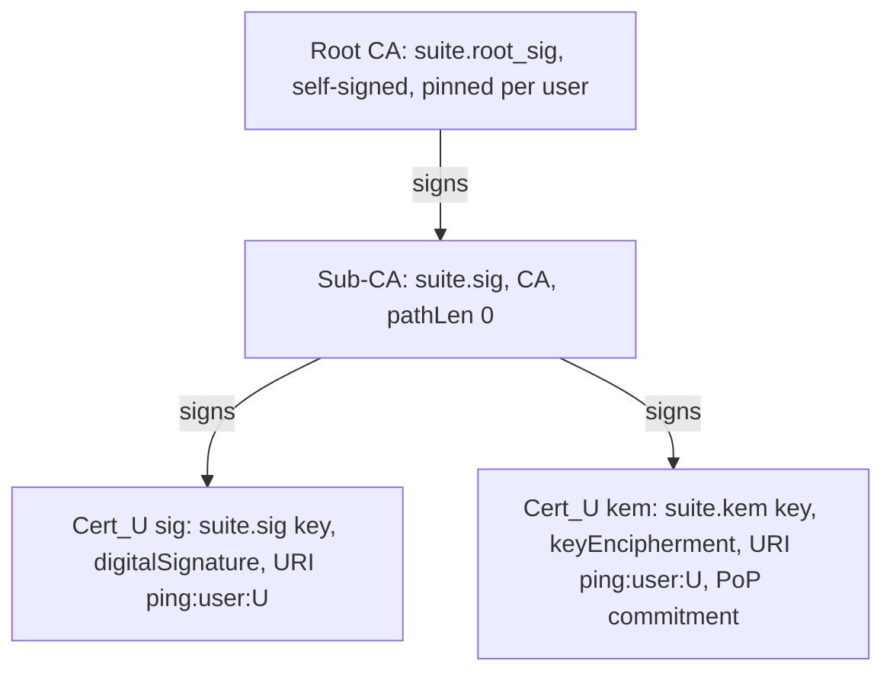

# Ping: secure messenger, basic plan (UC3M crypto project)

## Context
UC3M cryptography group project (2 students, 4 points). The brief (`Cryptography-Project-Goals-Assessment.pdf`) asks for a "simple Python app" with:
- multiple users, sign-up and login
- authenticated encryption of stored data
- digital signatures
- a mini-PKI (Root CA → Sub-CA) that certifies every user public key
- a report and an in-person defense

Points: PKI 1.0, report 1.0, AE 0.6, signatures 0.6, key management 0.5, auth 0.3.

This is the **lean** plan. `plan.md` holds the full design (TLS/mTLS, live CA service, revocation, rotation, …) and serves as the reference for the extensions at the end.

**Thesis.** The security of Ping comes from *how the pieces are put together*: certificate chains verified on every use, encrypt-then-sign, AAD binding, key commitment, sealed private keys. It doesn't come from any particular algorithm. The asymmetric algorithms are a swappable **suite** (`classic` or `pq`), and the whole test suite runs against both.

Decisions:
- One Python CLI app; users share one data directory on one machine. No network.
- The `cryptography` library for all crypto. Python 3.14, uv.
- The CA is an **offline admin command** (`ping ca approve`). No user process ever holds a CA key.
- Two key pairs per user (signing and KEM), each with its own certificate.
- KEM proof of possession is checked by readers through a commitment the CA puts in the KEM certificate (see Flow 3).
- Nothing will be committed (global rule).

## Algorithm suites
| Role | `classic` | `pq` |
|---|---|---|
| Root CA signature | Ed448 | ML-DSA-87 |
| Sub-CA and user signatures | Ed25519 | ML-DSA-65 |
| KEM (wraps the content key) | DHKEM(X25519, HKDF-SHA256), RFC 9180 §4.1 | ML-KEM-768 |
| **Fixed in both** | AES-256-GCM, HKDF-SHA256, HMAC-SHA256, SHA-256, Scrypt | same |

- **Why only the asymmetric parts swap:** Shor's algorithm breaks Ed25519 and X25519. Grover's algorithm only halves symmetric security, so AES-256, SHA-256 and Scrypt keep at least 128 bits and are already fine against quantum attacks.
- **Interfaces** (`suites.py`):
  ```python
  class SignatureScheme(Protocol):
      id: str
      def generate(self) -> PrivateKey: ...
      def sign(self, sk, msg: bytes) -> bytes: ...
      def verify(self, pk, msg: bytes, sig: bytes) -> None: ...   # raises InvalidSignature

  class KEM(Protocol):
      id: str
      def generate(self) -> PrivateKey: ...
      def encaps(self, pk) -> tuple[bytes, bytes]: ...             # (shared_secret, ciphertext)
      def decaps(self, sk, ct: bytes) -> bytes: ...

  @dataclass(frozen=True)
  class Suite:
      id: str                      # "ping-classic-v1" | "ping-pq-v1"
      root_sig: SignatureScheme
      sig: SignatureScheme
      kem: KEM
  ```
- **DHKEM for `classic`:** X25519 is Diffie–Hellman, not a KEM. `dhkem.py` implements RFC 9180 §4.1: an ephemeral key pair, `dh = X25519(skE, pkR)`, `enc = pkE`, `ss = LabeledExtractAndExpand(dh, kem_context = enc ‖ pkR)`. Both public keys go into the KDF. It's checked against the RFC 9180 Appendix A test vectors.
- **No downgrade:** the suite is chosen once (`init-pki --suite`), and the Root certificate's own algorithm commits to it. Each user pins the suite together with the Root fingerprint in their sealed trust file (see Key management). Every signed or AAD-protected structure carries `suite`, and every verifier rejects a mismatch. There is no negotiation.
- **No hard-coded sizes:** a signature is 64 B with Ed25519 and 3309 B with ML-DSA-65; a KEM ciphertext is 32 B vs 1088 B. Parsers take lengths from the data, never from constants.

## Threat model
- **Adversary:** anyone with read/write access to the shared data directory (other users of the app, or malware running as them). They can read, modify, delete, copy or add any file in it.
- **Goals against that adversary:**
  - They can't read anyone else's messages or private keys.
  - They can't forge a message, substitute someone's public key, or change a message undetected; the reader rejects it and says why.
  - They can't use a KEM key they don't hold the private half of.
- **Not defended (stated in the report):**
  - Deleting messages, or a whole conversation (availability).
  - Metadata: folder names and file times show who talks to whom, and when.
  - An attacker who steals the Sub-CA key and passphrase can certify fake keys.
  - Offline password guessing against a stolen key file (Scrypt only slows it down).
  - Python can't reliably wipe secrets from memory.

## PKI

- `init-pki` creates the Root (10-year validity) and the Sub-CA (5 years), each sealed under its own passphrase, and prints the Root fingerprint. The Root key is never used again unless the Sub-CA is re-issued.
- User certificates are valid for 1 year. **The CA builds them itself.** It ignores requested extensions and sets the subject CN, the SAN, KeyUsage, BasicConstraints (CA=false) and the PoP commitment extension.
- `pki.verify_chain(cert, purpose, at)` checks:
  - the signatures up to the pinned Root
  - validity at `at`
  - BasicConstraints and path length
  - the KeyUsage for `purpose` (`sign` or `kem`)
  - CN = the expected username
  - signature and key algorithms that match the pinned suite

  It's called **every time a public key is used**, never cached as "trusted".

## Storage layout (root = `--home`, repo-relative, default the repo root)
```text
keys/pki/                 root.key.json  sub.key.json  root.crt.pem  sub.crt.pem   # admin only
keys/users/<u>/           sign.key.json  kem.key.json  trust.json                   # sealed (K_file)
data/ca/requests/<u>.json # pending: CSR, KEM public key, binding signature
data/ca/issued/<u>/       sign.crt.pem  kem.crt.pem  pop_ct.bin                     # written by `ca approve`
data/ca/kem_index/<H(ek)> # every KEM key ever certified
data/users/<u>.json       # client_salt, kdf params, auth_salt, HMAC(K_auth)
data/directory/<u>.json   # public: sign cert, kem cert, PoP answer t   (= "active")
data/mail/<a>__<b>/<id>.json   # envelopes of the a↔b conversation (a < b alphabetically)
logs/                     # trace + audit, redacted
```
- `--home` must resolve inside the repo; this is checked after following symlinks. Tests use `resolve_home(tmp_path, allow_external=True)` from the API only.
- Every write is atomic (temporary file + `os.replace`). New files are created with `O_EXCL`. Key files are mode 0600 and `keys/` directories mode 0700.
- `keys/`, `data/`, `logs/`, `demo/` are gitignored.

## Key management
### Password → keys (`auth.py`)
1. Usernames match `^[a-z0-9_]{3,32}$`. Passwords are at least 12 characters.
2. `pw_key = Scrypt(password, client_salt, n=2^17, r=8, p=1)`. It's never stored and dropped after the split.
3. HKDF splits it into independent keys:
   - `K_auth` (`info="ping/auth"`): the login verifier is `HMAC(auth_salt, K_auth)`, compared with `hmac.compare_digest`
   - `K_file` (`info="ping/keyfile"`): seals the user's private keys and their trust file
4. Why split it: the verifier file (shared directory) gives nothing that decrypts key files. And the login check tells "wrong password" (verifier fails) apart from "key file tampered" (verifier passes, AES-GCM fails).

### Keystore container (`keystore.py`)
Every private key and every sealed file:
```json
{"v":1, "suite":"ping-pq-v1", "alg":"AES-256-GCM",
 "kdf":{"name":"scrypt","n":131072,"r":8,"p":1,"salt":"<16B>"} | {"name":"user-login"},
 "owner":"alice", "role":"root|sub|user-sign|user-kem|user-trust",
 "pub_fp":"<sha256 of public key DER, empty for trust>", "nonce":"<12B>", "ct":"<GCM(payload)‖tag>"}
```
- `ct = AESGCM(kek).encrypt(urandom(12), payload, aad=canon(all other fields))`. Changing the owner, role, suite or KDF parameters, or swapping files (including between users), breaks the tag.
- Opening checks the tag, then that the decrypted key's public key matches `pub_fp`, then that it matches its certificate.
- CA keys use `Scrypt(passphrase, salt)` with their own passphrases (at least 12 characters, entered twice, 3 tries). For tests and rehearsals, passphrases can come from `PING_<NAME>_PASSPHRASE_FILE`, which must be mode 0600. There's no plain environment variable.

### Trust anchor per user
- At sign-up, the user is shown the Root fingerprint and confirms it. It's stored with the suite in `keys/users/<u>/trust.json`, **sealed under `K_file`**.
- The shared `keys/pki/root.crt.pem` is only a convenience copy. A swapped Root in the shared directory doesn't match the user's sealed pin, so it's rejected.

## Flows
### Flow 1: `ping init-pki --suite classic|pq` (admin)
- Refuses if `keys/pki/` exists.
- Creates the Root and the Sub-CA, seals both, and prints the Root fingerprint and the suite.

### Flow 2: sign-up (user)
1. Enter a username and password (twice) and confirm the Root fingerprint.
2. Derive `pw_key` → `K_auth`, `K_file`. Generate `(sk, pk) ← sig.generate()` and `(dk, ek) ← kem.generate()`.
3. Write `data/users/<u>.json` (salts, KDF parameters, verifier). Seal `sign.key.json`, `kem.key.json` and `trust.json`.
4. Create `data/ca/requests/<u>.json` (`O_EXCL`, so a taken name fails):
   - a CSR signed with `sk`, CN = username
   - `ek`
   - `bind = Sig_sk(canon({"ctx":"ping/v1/kem-bind", suite, user, H(ek)}))`

The user is now **pending**.

### Flow 3: `ping ca approve <u>` (admin; `ping ca list` shows pending requests)
1. Verify the CSR's self-signature, CN == the requested name, and `bind` under the CSR key. Check that `H(ek)` isn't in `kem_index` and that the name hasn't been issued already.
2. **Proof-of-possession challenge:** `(ss, c) ← kem.encaps(ek)`; `t = HMAC(HKDF(ss, "ping/v1/kem-pop"), canon({suite, user, H(ek)}))`.
3. Issue `Cert_sig` and `Cert_kem`. `Cert_kem` carries a non-critical extension holding `H(t)`, so the CA signs a commitment to an answer only the holder of `dk` can compute.
4. Write `issued/<u>/` (both certificates and `c`) and `kem_index/<H(ek)>`. Delete the request. `ss` and `t` are discarded.

### Flow 4: login (user)
1. Recompute `pw_key` and check the verifier. Any failure gives a generic "wrong username or password".
2. Open `trust.json`, then the key files. `InvalidTag` here means a tampered file: abort and say so.
3. **First login after approval (activation):**
   - Load `issued/<u>/`, verify both certificates to the pinned Root, and check that the certified keys equal your own.
   - `ss = kem.decaps(dk, c)`, recompute `t`, and check `H(t)` against the extension.
   - Write `data/directory/<u>.json = {sign cert, kem cert, t}`. The user is now **active**.
4. Open the menu.

**Why this is a proof of possession that readers can check:** a sender only encrypts to a KEM certificate whose directory entry carries a `t` with `H(t)` equal to the CA-signed extension. Only the holder of `dk` can compute `t` from `c`. Someone who submitted another user's `ek` gets certificates they can never activate, and copying files into the directory by hand doesn't help, because readers check the commitment themselves. Readers never have to trust the app code that does the activation.

### Flow 5: send (A → B)
1. Load B's directory entry and run `verify_chain` on both certificates (`kem` purpose, CN = bob, pinned Root and suite). Check `H(t)` against B's KEM certificate extension. Refuse if B isn't active, and refuse sending to yourself.
2. `cek ←$ 32 B`, `n ←$ 12 B`, `msg_id ←$ 16 B`.
3. Header:
   ```json
   {"v":1, "suite":"ping-pq-v1", "msg_id":"…", "sender":"alice", "recipient":"bob", "ts":"…",
    "sender_sign_fp":"…", "sender_kem_fp":"…", "recipient_kem_fp":"…",
    "cek_commit": "HMAC(cek, 'ping/v1/commit')"}
   ```
4. `body.ct = AESGCM(cek).encrypt(n, plaintext, aad=canon(header))`.
5. For R in {bob, alice}:
   - `(ss_R, kem_ct_R) = kem.encaps(ek_R)`
   - `kek_R = HKDF(ss_R, info=canon({"ctx":"ping/v1/wrap", suite, "r":R, "h":H(canon(header))}))`
   - `wrapped_R = AESGCM(kek_R).encrypt(n_R, cek, aad=canon({"r":R}))`
6. `sig = Sig_skA(canon({"ctx":"ping/v1/envelope", header, body, wraps}))` (encrypt-then-sign).
7. Write `data/mail/alice__bob/<msg_id>.json` with `O_EXCL`.

Envelope on disk (binary fields as canonical base64url):
```json
{"header": {...}, "body": {"nonce":"…","ct":"…"},
 "wraps": {"alice": {"kem_ct":"…","nonce":"…","wrapped_cek":"…"},
           "bob":   {"kem_ct":"…","nonce":"…","wrapped_cek":"…"}},
 "sig": "…"}
```
`canon(x) = json.dumps(x, sort_keys=True, separators=(",",":"), ensure_ascii=True).encode()`.

### Flow 6: read a conversation (`open <peer>`)
For every file in `data/mail/<me>__<peer>/`, check fail-closed, in this order:
1. **Parse strictly:** reject duplicate JSON keys, unknown or missing fields, non-canonical base64url, and wraps that aren't exactly `{sender, recipient}`.
2. **Suite** == my pinned suite.
3. **Sender certificate:** load the directory entry for `header.sender`, run `verify_chain(sign cert)`, and check its fingerprint == `sender_sign_fp`.
4. **Signature** over `canon({ctx, header, body, wraps})`.
5. **Addressing:** {sender, recipient} == {me, peer}, the folder name matches, and my KEM fingerprint is in the header.
6. **Unwrap my copy:** `kem.decaps` → HKDF → AES-GCM. Then check `HMAC(cek, …) == cek_commit` (makes AES-GCM key-committing, so one ciphertext can't decrypt to different messages for the two readers).
7. **Decrypt** the body with `aad=canon(header)`.

Display:
- Messages are sorted by `ts`, then `msg_id`. `ts` is set by the sender, which is acceptable because it's signed and only the two participants write the conversation.
- Duplicates by `msg_id` are shown once.
- A message that fails any step shows as `⚠ REJECTED (<file>): <reason>`, never as plaintext, and is written to the audit log.

## Modules (`src/ping/`)
| Module | Contents |
|---|---|
| `suites.py` | `SignatureScheme`, `KEM`, `Suite`, `CLASSIC`, `PQ`, `get_suite(id)` |
| `dhkem.py` | RFC 9180 DHKEM(X25519, HKDF-SHA256) |
| `auth.py` | Scrypt, HKDF split, verifier create/check |
| `keystore.py` | `seal`, `open`, `assert_pair` |
| `pki.py` | `init_pki`, `make_csr`, `issue_user`, `verify_chain`, fingerprints, PoP commitment extension |
| `ca.py` | `list_requests`, `approve` |
| `messaging.py` | `canon`, `parse_envelope`, `seal`, `open_envelope`, `MessageRejected(reason)` |
| `storage.py` | atomic and exclusive writes, `resolve_home`, username regex |
| `trace.py` | `--trace` crypto trace, audit log, redaction |
| `cli.py` | commands and the user menu |

## CLI
- `ping init-pki --suite classic|pq`
- `ping ca list` / `ping ca approve <user>`
- `ping signup` / `ping login`. The logged-in menu has:
  - `chats`: conversations with a message count
  - `open <peer>`: shows the conversation; type a line to send, `/refresh` re-reads, `/back` returns
  - `fingerprints`: my certificate fingerprints and the pinned Root
  - `logout`
- Global flags: `--home`, `--trace`.

`--trace` prints one line per crypto step with algorithm and sizes, for example `[A→B] ML-KEM-768.Encaps(ek_bob) → ss 32 B, c 1088 B`, `Ed25519.Sign → σ 64 B`, and `✔`/`✘ <reason>` per opening step. The audit log records login failures, tampered key files, rejected messages and CA approvals. Redaction drops fields named `password, pw_key, k_auth, k_file, sk, dk, cek, kek, ss, t, plaintext`.

## Grade mapping
| Criterion | Where it's covered |
|---|---|
| Auth 0.3 | Scrypt with salt, HKDF split, constant-time HMAC verifier, generic errors |
| Key mgmt 0.5 | password-derived `K_file` seals private keys and the trust pin; separate CA passphrases; Root used only at init; KEM proof of possession; a key pair per purpose |
| AE 0.6 | AES-GCM on messages (header as AAD) and on every key file (metadata as AAD) |
| Signatures 0.6 | every envelope, CSR and binding signed; verified before any decryption |
| PKI 1.0 | Root → Sub-CA → two certificates per user, CA-controlled extensions, chain verified on every use, suite pinned |
| Report 1.0 | property-based argument (EUF-CMA signature, IND-CCA KEM, AEAD), two instantiations, threat model, limitations |

## Stage 1: core (in order)
0. **Probes** (in the scratchpad):
   - an X25519 public key in an X.509 certificate signed by Ed25519
   - an Ed448 Root and an ML-DSA chain through `x509.verification`, with the manual fallback `verify_directly_issued_by` plus KU/BC/validity checks
   - reading a custom non-critical extension back
1. `suites.py`, `dhkem.py` (with the RFC vectors), `auth.py`, `keystore.py`, `storage.py`, with unit tests.
2. `pki.py` and `ca.py`, `init-pki`, sign-up, `ca approve`, login with activation. **Checkpoint: two active users under both suites.**
3. `messaging.py`, the `chats` / `open` menu, `--trace`, audit log, with envelope and tamper tests.
4. `scripts/tamper_demo.py` and a demo rehearsal under both suites.

## Testing (`uv run pytest`)
- **Fixtures:** `tmp_path` home, fast Scrypt (n=2^10), passphrase files, a `users(alice, bob, mallory)` factory, a `rogue_ca` (separate Root and Sub-CA). **Every test is parametrized over `suite ∈ {classic, pq}`.**
- `test_dhkem.py`: the RFC 9180 test vectors; encaps/decaps round trip; a wrong key gives a different secret.
- `test_auth.py`: verify ok and wrong-password fail; fresh salts; deterministic split; `K_auth != K_file`; short password refused.
- `test_keystore.py`:
  - round trip
  - wrong password → `InvalidTag`
  - changing any one field, swapping two users' files, or swapping sign and KEM files fails
  - fresh nonce on re-seal; mode 0600
  - `assert_pair` rejects a mismatched key
- `test_pki.py`:
  - the chain verifies
  - rejected: rogue Root, swapped Root file (user's sealed pin), expired, wrong purpose (KEM certificate used as signing and the reverse), CA certificate as a leaf, path length, suite mismatch
  - the CA ignores requested extensions
  - approval rejected: bad CSR signature, bad binding, reused `ek`, name already issued
- `test_pop.py`:
  - activation works
  - a request carrying someone else's `ek` gets certificates that can't be activated
  - a directory entry with a forged `t` is refused by senders
- `test_messaging.py` (each case raises `MessageRejected` with the expected reason):
  - round trip; both participants can read
  - changing any header field, body ct or nonce, any wrap field, or the signature
  - non-canonical base64, a duplicate JSON key, an extra wrap
  - an envelope copied into another conversation (addressing)
  - signed by mallory's valid certificate under alice's name
  - a KEM certificate from a rogue CA swapped into the directory
  - different CEKs wrapped for the two readers (commitment)
  - suite downgrade (a `classic` envelope in a `pq` deployment)
  - a duplicate `msg_id` is shown once
- `test_storage.py`: path-traversal usernames, `--home` escapes (absolute path, `~`, `../`, symlink), atomic and exclusive writes.
- `test_e2e.py`:
  - sign-up → approve → activate → send → read, for both users
  - logs contain no password, `K_auth`, CEK or plaintext
  - audit events appear for login fail and message rejected

## Demo (one terminal, about 5 minutes)
1. `ping init-pki --suite classic`, two sign-ups, `ca approve` both, log in (activation shown in the trace).
2. Alice ↔ Bob conversation with `--trace`.
3. `scripts/tamper_demo.py`: flip a byte in an envelope, swap Bob's KEM certificate for a rogue one, copy an envelope into another conversation, forge a sender. Each prints `ATTACK → REJECTED: <reason>`.
4. Repeat steps 1–2 with `--suite pq` and compare the trace sizes (64 B vs 3309 B signatures, 32 B vs 1088 B KEM ciphertexts).

## Known limitations (report)
- **No revocation:** a stolen key stays valid until its certificate expires.
- **No forward secrecy:** a stolen `dk` plus password decrypts all past messages to that user.
- **Deletion and metadata:** messages can be deleted, and the conversation metadata is visible on disk.
- **CA trust:** a stolen Sub-CA key and passphrase can certify fake keys. There's no key pinning between users.
- **Identity:** "approval" is an admin action, not identity proofing.
- **Memory:** secrets can't be reliably wiped from Python memory.

## Extensions (only after Stage 1; designs in `plan.md`)
In order of value per effort:
1. a `hybrid` suite (X25519+ML-KEM KEM combiner, Ed25519+ML-DSA dual signature): one more `Suite` entry
2. TOFU pins and safety numbers between users
3. password change (re-seal with journal and recovery)
4. client/server over TLS 1.3 + mTLS
5. live two-round KEM proof of possession with an online CA service
6. revocation (CRL), then key rotation
7. sealed local chat history, unread counts, live delivery
8. `status`, tamper-evident audit log
