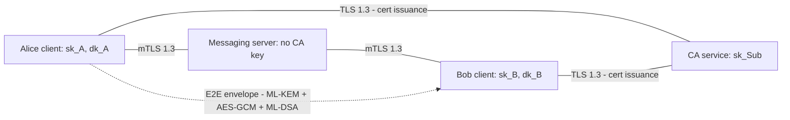
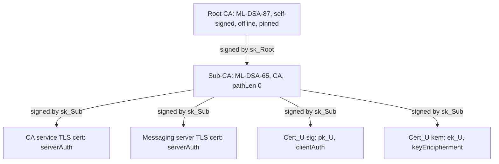
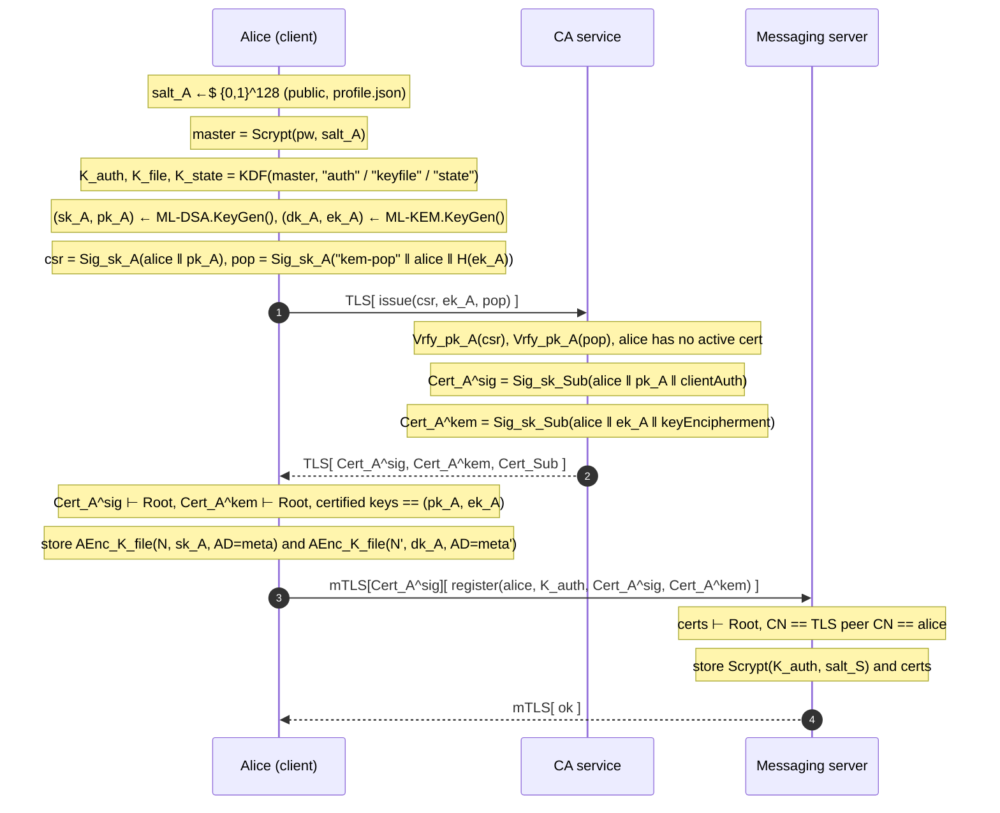
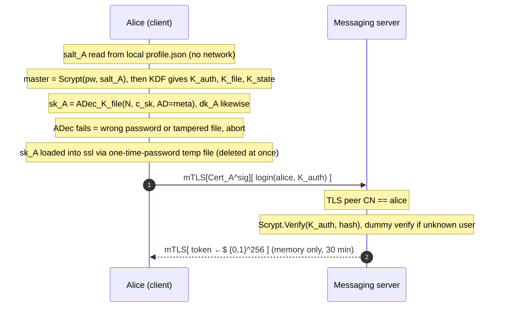
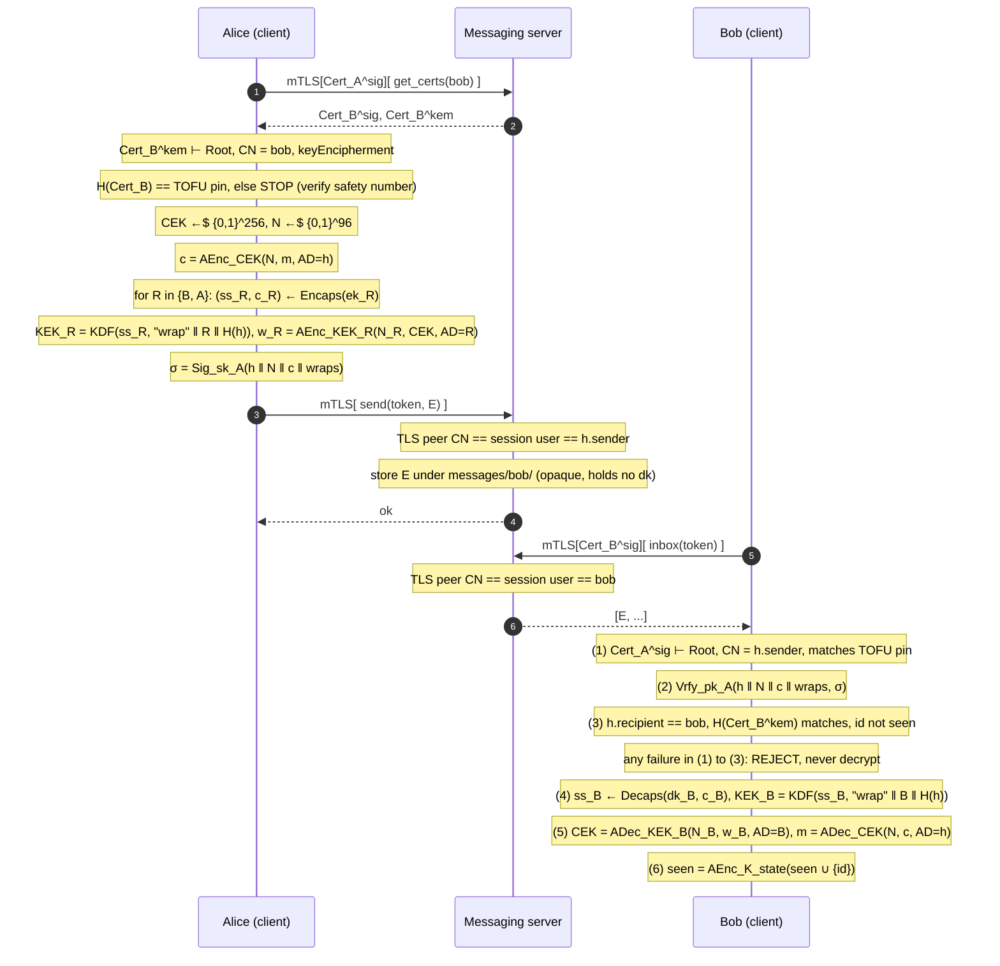

# Ping: PQC secure messenger (UC3M crypto project)

## Context
This is the UC3M cryptography group project, and the repo is empty (`main.py` hello-world, `pyproject.toml`, Python 3.14, uv). The brief (`Cryptography-Project-Goals-Assessment.pdf`) asks for:
- multiple users, sign-up and login
- authenticated encryption of stored data
- digital signatures
- a mini-PKI (Root CA → Sub-CA) that certifies every user or system public key
- a report and an in-person defense

Points: PKI 1.0, report 1.0, AE 0.6, signatures 0.6, key management 0.5, auth 0.3.

Decisions so far:
- A client–server messenger over **TLS 1.3 with mutual TLS (mTLS)**.
- A transport abstraction so the app can fall back to local, in-process mode.
- The `cryptography` library for all crypto.
- **Pure post-quantum algorithms.**
- A **separate ML-KEM certificate** per user.
- Authenticated encryption for private keys at rest.
- **Close the server man-in-the-middle (MITM) gap:** the messaging server must not be able to issue certificates.

Already confirmed in the scratchpad probe (cryptography 50.0.2, ssl on OpenSSL 3.5.7):
- ML-DSA CA, CSR and leaf certificates build correctly.
- `x509.verification` ClientVerifier accepts a URI SAN.
- ML-KEM public keys can go in certificates.
- An mTLS handshake with ML-DSA certificates on both sides succeeds.

Already done: `uv add cryptography`. Nothing will be committed (global rule).

## Algorithm suite
| Purpose | Algorithm |
|---|---|
| Root CA | ML-DSA-87 |
| Sub-CA, CA-service TLS, messaging-server TLS, user signing/mTLS | ML-DSA-65 |
| User encryption | ML-KEM-768 (own certificate, KeyUsage keyEncipherment only) |
| Message body | AES-256-GCM with a random 256-bit content key (CEK) |
| CEK wrapping | ML-KEM-768 encapsulate → HKDF-SHA256 → AES-256-GCM |
| Signatures | ML-DSA-65, encrypt-then-sign |
| Passwords | Client Scrypt → HKDF split; server Scrypt again |
| Private keys and client state at rest | Own AEAD container (AES-256-GCM, metadata as AAD), file mode 0600 |
| Transport | TLS 1.3 only. OpenSSL 3.5 defaults to hybrid X25519MLKEM768 key exchange |

## Architecture: three separate trust domains
```
                 ┌───────────── Root CA (offline: key used only by `ping init-pki`)
                 │ signs
   ┌─────────────▼────────────┐   issue certs (TLS)   ┌───────────┐
   │ CA service  `ping ca`    │◀──────────────────────│           │
   │ holds Sub-CA key         │   get_certs / get_crl │  client   │
   │ ca_service.py + ca store │──────────────────────▶│ (per user)│
   └──────────────────────────┘                       │           │
   ┌──────────────────────────┐   mTLS (user cert)    │           │
   │ Messaging server         │◀─────────────────────▶│           │
   │ `ping server`            │  register/login/send/ └───────────┘
   │ NO CA key, only Root cert│  inbox/get_certs
   └──────────────────────────┘
```
- **Two services, two processes, two data directories:**
  - `ca_service.py`, run as `ping ca`. Sub-CA key in `keys/pki/sub/`, issuance records in `data/ca/`.
  - `service.py` (messaging), run as `ping server`, data in `data/server/`.
  - Both run on a generic `tlsserver.py` (ssl + ThreadingTCPServer + `protocol.py` framing). Each has its own TLS certificate from the Sub-CA (SAN `localhost`, different ports and CNs: `ping-ca` and `ping-server`).
- **Backends:**
  - `LocalBackend` holds a `CAService` and a `MessagingService` as separate objects. Only the CA object ever holds the Sub-CA key.
  - `RemoteBackend` holds two TLS connections.
  - `--mode remote|local`. Client crypto is the same in both modes.
- **mTLS policy, messaging server:**
  - `CERT_REQUIRED` for every request, including `register`. The user already has certificates from the CA by then.
  - The server checks that the client certificate's CN equals the request's username or the session's username.
  - The CRL is enforced in stage 2.
- **CA service:** TLS with the server certificate only, because new users have no client certificate yet. `issue` is unauthenticated, first come first served. In a real system the CA would verify identity, for example by email; that's out of scope and stated in the report.

## End-to-end data flows

### Notation
| Symbol | Meaning |
|---|---|
| `A`, `B`, `CA`, `S` | Alice, Bob, CA service (holds `sk_Sub`), messaging server |
| `sk_X / pk_X` | X's ML-DSA-65 signing / verification key (`sk_Root`: ML-DSA-87) |
| `dk_X / ek_X` | X's ML-KEM-768 decapsulation / encapsulation key |
| `Cert_X^sig`, `Cert_X^kem` | X.509 certificate binding X to `pk_X` / `ek_X`, signed by `sk_Sub` |
| `Sig_sk(m)`, `Vrfy_pk(m, σ)` | ML-DSA sign / verify |
| `(ss, c) ← Encaps(ek)`, `ss ← Decaps(dk, c)` | ML-KEM-768 |
| `AEnc_K(N, m, AD)`, `ADec_K(N, c, AD)` | AES-256-GCM with nonce N and associated data AD (ADec outputs ⊥ on a bad tag) |
| `KDF(ikm, info)` | HKDF-SHA256 |
| `H(x)` | SHA-256 |
| `x ←$ {0,1}^n` | uniformly random n bits (`os.urandom`) |
| `‖` | concatenation (in practice `canon()` encoding) |
| `⊢ Root` | certificate chain verified to the pinned Root (validity, EKU/KeyUsage, CN) |
| `TLS[...]`, `mTLS[Cert]` | TLS 1.3 channel (X25519MLKEM768), with client certificate for mTLS |

### Trust domains and protection layers

The server sees who → whom, when, and size. It cannot read, modify, forge, or MITM.

### PKI hierarchy (created by `ping init-pki`, once)

Every private key is stored as `AEnc_KEK(N, sk, AD = meta)` with `KEK = Scrypt(passphrase, salt)` (see Keystore). The Root key is never loaded again after bootstrap.

### Flow 1: sign-up


### Flow 2: login


### Flow 3: send (A → B) and receive
Envelope: `E = (h, N, c, {(c_R, N_R, w_R)} for R ∈ {B, A}, σ)`, where
- `h = (id, A, B, ts, H(Cert_A^sig), H(Cert_B^kem))`, with `id ←$ {0,1}^128`
- `c = AEnc_CEK(N, m, AD = h)`, with `CEK ←$ {0,1}^256` and `N ←$ {0,1}^96`
- `(ss_R, c_R) ← Encaps(ek_R)`, `KEK_R = KDF(ss_R, "wrap" ‖ R ‖ H(h))`, `w_R = AEnc_KEK_R(N_R, CEK, AD = R)`
- `σ = Sig_sk_A(h ‖ N ‖ c ‖ wraps)`



## Sign-up flow
1. The client generates ML-DSA-65 and ML-KEM-768 key pairs.
2. **Client → CA `issue`** with:
   - an ML-DSA CSR (CN = username)
   - the ML-KEM public key
   - a KEM proof of possession: `ML-DSA.sign(canon({username, kem_pub_fp, "ping/kem-pop"}))`
3. **The CA checks the request:**
   - the CSR signature is valid and the proof-of-possession signature verifies under the CSR's key
   - the username is valid and has **no active certificate** (one active pair per username). Re-issuing needs revocation first (stage 2).
4. **The CA builds both certificates itself.** It ignores the requested extensions, sets the subject, SAN `ping:user:<name>`, KeyUsage and EKU, then signs. It writes an issuance record to `data/ca/issued/<user>.json` and returns the certificates plus the chain.
5. **The client verifies the certificates:** chain to the pinned root, CN = username, and the public keys equal its own. It then seals and saves the keys.
6. **Client → server `register`** over mTLS, presenting the new signing certificate. It sends:
   - the username
   - `auth_key`
   - both certificates

   The server verifies the certificates against the Root, checks that CN = username, and stores the account.

## Closing the MITM gap
Who could attempt a MITM, and why it fails:

| Adversary | Attempt | Why it fails |
|---|---|---|
| Network attacker | Intercept or alter traffic | TLS 1.3 with the server certificate chained to the pinned Root; mTLS on the messaging server; the E2E layer underneath |
| **Malicious messaging server** | Hand Alice a fake "bob" KEM certificate so it can decrypt | It has no CA key, so it can't create a certificate that chains to the Root. Clients verify every certificate they receive. |
| Malicious messaging server | Serve an old revoked Bob certificate | Clients check the CA's CRL (stage 2), and the CA allows one active pair per name |
| Malicious messaging server | Register as "bob" before Bob does | That's squatting, not a MITM. The CA refuses the real Bob's registration, so it's visible. Prevented properly only by identity proofing, which is out of scope. |
| **Compromised CA service** | Issue a second valid "bob" pair | **Key pinning (trust on first use, TOFU):** the client pins each contact's certificate fingerprints on first contact in `data/clients/<me>/contacts.json` (sealed). Any change → hard stop: "bob's keys changed – verify". **Safety numbers:** `verify <contact>` shows `SHA-256(sorted(my sign+kem fps ‖ their fps))` as 12 groups of 5 digits. The two users compare them in person and mark the contact verified. A key change on a verified contact is never accepted silently. |
| Root CA compromise | Anything | Same pinning and safety numbers. Out of scope beyond that; the key is offline. |

What stays possible: the server can see metadata and can drop or delay messages. It can't read, modify, forge or MITM them.

## Keystore: authenticated encryption of private keys (`keystore.py`)
Every private key file (Root CA, Sub-CA, two TLS keys, user sign and KEM) is a JSON container:
```json
{"v":1, "alg":"AES-256-GCM", "kdf":{"name":"scrypt","n":131072,"r":8,"p":1,"salt":"<16B>"} | {"name":"login"},
 "owner":"alice", "role":"user-sign|user-kem|root-ca|sub-ca|ca-tls|server-tls",
 "pub_fp":"<sha256 of public key DER>", "nonce":"<12B>", "ct":"<GCM(PKCS#8 DER)‖tag>"}
```
- **Wrapping key (KEK):**
  - CA and server keys: `Scrypt(passphrase, salt)`, with the parameters stored in the file.
  - User keys: `keyfile_key = HKDF(master, info="ping/keyfile")`.
- **Encryption:** `ct = AESGCM(kek).encrypt(urandom(12), pkcs8_der, aad=canon({v, alg, kdf, owner, role, pub_fp}))`.
  - Swapping files, changing the owner or role, or editing the KDF parameters (a downgrade) all break the tag.
- **Opening:**
  1. `InvalidTag` means a wrong passphrase or a tampered file. The two can't be told apart, by design.
  2. Check that the public key's SHA-256 equals `pub_fp`.
  3. `assert_pair` with the certificate.
- **Writes** are atomic (temporary file + `os.replace`), mode 0600, with a fresh nonce on every re-encryption.
- **Getting a key into `ssl`.** `load_cert_chain` only accepts file paths. So:
  1. The decrypted key is re-serialized as PKCS#8 encrypted with a random 32-byte one-time password, held only in memory.
  2. It's written to a `mkdtemp()` directory with mode 0700.
  3. `load_cert_chain(cert, tmp, password=otp)` is called, and the file is deleted in a `finally` block.

  The disk never holds the key unencrypted, and the temporary copy's password never touches disk.
- **Sealed client state:** the replay cache (`seen.json`) and the contact pins (`contacts.json`) use the same container with `HKDF(master, "ping/state")`. Editing or deleting them is detected.

## Secrets: validation and how they get loaded
### CA and server passphrases
- **Creation (`init-pki`):**
  - Prompted with `getpass`, entered twice, minimum 12 characters.
  - Separate passphrases for the Root CA, Sub-CA, CA-service TLS and messaging-server TLS.
  - Each key is stored as a keystore container. No passphrase hash is stored anywhere.
- **Validation:**
  1. The GCM tag over the key and its metadata verifies, or `InvalidTag` is raised ("wrong passphrase or corrupted key file").
  2. Then the `pub_fp` check and `assert_pair(private_key, cert)` confirm the key belongs to the certificate on disk (catches a swapped certificate).

  Three failed attempts → exit.
- **How keys are loaded into the process:** `config.get_passphrase(name)`:
  1. `PING_<NAME>_PASSPHRASE_FILE` (the file must be mode 0600, otherwise it's refused). For tests and scripted demos.
  2. Otherwise an interactive `getpass` prompt.

  There is no plain env var holding the passphrase, because it would be visible in the process environment.
- **Who holds which key at runtime:**
  - `ping ca`: the Sub-CA key in memory, plus its own TLS key.
  - `ping server`: only its TLS key, plus the Root certificate.
  - The Root CA key is loaded only inside `init-pki` (and when re-issuing the Sub-CA).
  - Limitation for the report: Python can't reliably wipe secrets from memory.

### Trust anchor
- `init-pki` prints the Root certificate's SHA-256 fingerprint.
- The client reads `keys/pki/root/root_ca.crt.pem` and stores its pinned fingerprint in `data/clients/trust.json`. The user confirms it on first run; after that a mismatch is a hard failure.
- The root is the only anchor in `ssl` (`load_verify_locations`) and in `x509.verification.Store`. System CAs are never loaded.

### User passwords
1. `client_salt` is generated at sign-up and kept in `data/clients/<user>/profile.json`. It's public, and the server never needs it. Keeping it local breaks the cycle where login needs mTLS, mTLS needs the signing key, and the signing key needs the salt. It also removes any username-probing endpoint.
2. `master = Scrypt(password, client_salt, n=2^17, r=8, p=1)`.
3. Derive three keys from `master` with HKDF:
   - `auth_key` (`info="ping/auth"`): sent to the server over mTLS.
   - `keyfile_key` (`info="ping/keyfile"`): stays local.
   - `state_key` (`info="ping/state"`): stays local.
4. The server stores `Scrypt(auth_key, server_salt)` together with its parameters. It checks with `Scrypt.verify` (constant time), and does a dummy verify for unknown users. The server never sees anything that decrypts the key files.

## How the envelope is protected
Wire and disk format: JSON, binary fields base64url.
```json
{
  "header":  {"v":1, "msg_id":"<16B rand>", "sender":"alice", "recipient":"bob",
              "ts":"2026-10-26T19:00:00Z", "sender_sign_cert_fp":"<sha256>",
              "recipient_kem_cert_fp":"<sha256>"},
  "body":    {"nonce":"<12B>", "ct":"<AES-GCM ciphertext‖tag>"},
  "wraps":   {"bob":   {"kem_ct":"<1088B>", "nonce":"<12B>", "wrapped_cek":"<48B>"},
              "alice": {"kem_ct":"…", "nonce":"…", "wrapped_cek":"…"}},
  "sig":     "<ML-DSA-65 signature, 3309B>"
}
```
`canon(x)` = `json.dumps(x, sort_keys=True, separators=(",",":"), ensure_ascii=True).encode()`. It's deterministic, so the signer and the verifier process exactly the same bytes.

**Sealing (on Alice's client):**
1. Resolve Bob's certificates. Check the chain to the pinned root, CN, purpose, validity, and the TOFU pin. A missing or changed pin stops the send until the user verifies.
2. `cek = urandom(32)`, `n = urandom(12)`.
3. `body.ct = AESGCM(cek).encrypt(n, plaintext, aad=canon(header))`. This gives confidentiality and integrity, and binds the header (the AAD) to the body.
4. For each reader R in {recipient, sender}:
   1. `(ss, kem_ct) = R_kem_pub.encapsulate()`.
   2. `kek = HKDF-SHA256(ss, info="ping/v1/wrap" ‖ R ‖ sha256(canon(header)))`.
   3. `wrapped_cek = AESGCM(kek).encrypt(n_R, cek, aad=R)`.
5. `sig = alice_sign.sign(canon({header, body, wraps}))`. The signature covers everything, including both names and the recipient key fingerprint. That stops a forwarded or re-addressed copy from being accepted.

**Opening (on Bob's client).** Fail-closed, in this order:
1. **Chain and pin:** resolve the certificate by `sender_sign_cert_fp`. Verify the chain to the root, validity, EKU, CN = `header.sender`, and the TOFU pin.
2. **Signature:** verify `sig` over `canon({header, body, wraps})`.
3. **Addressing:** `recipient == me`, `recipient_kem_cert_fp == my KEM certificate`, and `msg_id` isn't in the sealed `seen.json`.
4. **Unwrap:** decapsulate → HKDF → unwrap the CEK.
5. **Decrypt:** decrypt the body with `aad=canon(header)`, then record `msg_id` as seen.

When the messaging server accepts an upload, it also checks that the mTLS CN, the session username and `header.sender` all match. That's defense in depth; clients don't rely on it.

## Files (new unless noted)
- `pyproject.toml` (modify): `[project.scripts] ping = "ping.cli:main"`, uv_build backend, description, pytest dev dependency.
- `main.py` (modify): shim calling `ping.cli.main`.
- `.gitignore` : `.venv/`, `__pycache__/`, `.pytest_cache/`, `keys/`, `data/`, `.DS_Store`.

## Runtime directory layout (all gitignored, root = `PING_HOME`, default the repo root)
```text
keys/                              # ALL key material and certificates
  pki/root/   root_ca.key.json  root_ca.crt.pem          # Root key: only used by init-pki
  pki/sub/    sub_ca.key.json   sub_ca.crt.pem  sub_ca.crl.pem
  pki/tls/    ca.key.json  ca.crt.pem  server.key.json  server.crt.pem
  users/<u>/  sign.key.json  kem.key.json  sign.crt.pem  kem.crt.pem
data/                              # app state, no private keys
  ca/issued/<u>.json               # CA issuance records
  server/users/<u>.json            # Scrypt(K_auth) + certs
  server/messages/<recipient>/<id>.json   # E2E envelopes
  clients/trust.json               # pinned Root fingerprint
  clients/<u>/  profile.json  seen.json  contacts.json   # last two sealed
```
- `*.key.json` files are keystore containers (AES-256-GCM), mode 0600. Directories under `keys/` are mode 0700.
- `ping init-pki` refuses to overwrite an existing `keys/pki/`. To reset: `rm -rf keys data`.
- Tests and the tamper demo set `PING_HOME` to a temporary directory, so they never touch the repo's `keys/` or `data/`. One-off probes and scratch scripts write only to the session scratchpad, never the repo.
- **`src/ping/` core:**
  - `config.py`: paths, `get_passphrase`, `now()` clock that tests can override, `KdfParams`.
  - `log.py`: `crypto_log(op, alg, detail)` (report screenshots).
  - `storage.py`: atomic JSON store, username regex `^[a-z0-9_]{3,32}$`.
  - `auth.py`: client-side derivation, server-side hash and verify.
  - `keystore.py`: `seal_key`, `open_key`, `assert_pair`, `ssl_load_key`, `seal_state`, `open_state`.
- **`src/ping/` PKI and messaging:**
  - `pki.py`: Root, Sub-CA and TLS certificate creation, user certificate issuance, CSR and proof-of-possession helpers, `verify_cert(cert, purpose, at)`, fingerprints.
  - `contacts.py`: TOFU pins, safety numbers, the verified flag.
  - `messaging.py`: `canon`, `seal`, `open_envelope`, `MessageRejected(reason)`.
- **`src/ping/` services and transport:**
  - `ca_service.py`: `issue`, `get_certs`, the issuance store, and (stage 2) revoke and CRL.
  - `service.py`: messaging — register, login, logout, get_certs, send, inbox.
  - `protocol.py`: 4-byte length prefix + JSON, 1 MiB cap.
  - `tlsserver.py`: generic TLS server with handler dispatch, used by both services.
  - `backend.py`: `LocalBackend` and `RemoteBackend`, each exposing `ca` and `msg` sides.
  - `client.py`, `cli.py`: subcommands `init-pki`, `ca`, `server`, `client --mode`. Client menu: register, login, send, inbox, contacts/verify, show my fingerprints, logout.

## Stage 1: core app (this pass)
0. Copy this plan to `plan.md` at the repo root (left uncommitted) so it can be referred to during implementation and turned into the report.
1. Config, log, storage, auth, keystore, pki, plus `init-pki` and the unit tests for these.
2. CA service, messaging service, LocalBackend, CLI register/login. **Checkpoint: local mode works end to end.**
3. Messaging, contacts (TOFU pins and safety numbers), send/inbox in local mode, with envelope, tamper and MITM tests.
4. Protocol, `tlsserver`, both TLS services, RemoteBackend, with integration and TLS tests.

## Stage 2: extras (after the stage-1 checkpoint)
1. **Password change.** Runs over an authenticated session.
   1. Derive the old keys and open the key files (proves the old password).
   2. Generate a new `client_salt`, derive the new keys, and re-seal the keys, `seen.json` and `contacts.json` into `*.json.new` with fresh nonces. Write `profile.json.new` with the new salt.
   3. Call `change_password(old_auth, new_auth)`. The server verifies and atomically replaces the record.
   4. On success, `os.replace` the `.new` files into place. On failure, delete them.
   5. Other sessions for that user are invalidated.

   Certificates are unchanged.
2. **Revocation and CRL.**
   - Run by the CA service: `ping ca revoke <user> --reason keyCompromise` adds both serials to a CRL signed with ML-DSA-65 (`next_update` = 7 days), written to `keys/pki/sub/sub_ca.crl.pem`. The user's slot becomes free for re-issue.
   - `get_crl` endpoint on the CA.
   - **Messaging server:** fetches the CRL and loads it into its TLS context (`VERIFY_CRL_CHECK_LEAF`), rebuilding the context when the CRL changes. A revoked user can't complete mTLS.
   - **Client `verify_cert`:** checks the CRL signature against the Sub-CA, freshness, and whether the serial is listed.
   - Messages from revoked senders are rejected, because the sender sets the timestamp and it can't be trusted.
   - A re-issued contact shows as a pin change, so the user verifies the safety number again.
   - Probe first that ML-DSA CRLs work in both `cryptography` and the `ssl` module's OpenSSL.
3. **Tamper and MITM demo**, `scripts/tamper_demo.py`. Uses a temporary `PING_HOME` and passphrase files, registers alice and bob, and sends a real message. It then runs every attack in the test catalogue below and prints `ATTACK → REJECTED: <reason>` for the report screenshots. It shares its scenario helpers with the tests.

## Testing strategy
- **Tools:** `pytest` (dev dependency). Run with `uv run pytest`.
- **Fixtures (`tests/conftest.py`):**
  - `tmp_path` as `PING_HOME`
  - a session-scoped test PKI
  - fast `KdfParams` (n=2^10), injected only by the fixture
  - a fixed clock via `config.now`
  - a `users(alice, bob, mallory)` factory
  - a `rogue_ca` fixture: a separate root and sub-CA
  - a `malicious_server` fixture: a messaging service subclass that substitutes certificates and envelopes
- **Layers:**
  - Unit tests.
  - Integration tests parametrized over `["local", "remote"]`, with the same test bodies in both modes.
  - The remote tests start the real TLS services on `127.0.0.1:0` in threads.

### Unit tests
- `test_auth.py`: hash then verify; wrong password fails; fresh salts; parameters stored with the hash; client derivation is deterministic and the three derived keys are all different; an unknown user and a wrong password take similar time (dummy verify).
- `test_keystore.py`:
  - Round trip for ML-DSA and ML-KEM keys.
  - A wrong passphrase raises `InvalidTag`.
  - Mutating any one of ct, nonce, owner, role, pub_fp or kdf fails; swapping the sign and KEM files fails.
  - Fresh nonce on every re-seal; mode 0600.
  - `assert_pair` rejects a mismatched key.
  - `ssl_load_key` leaves its temporary directory empty.
  - The passphrase file is refused if its mode isn't 0600.
  - Tampered `seen.json` or `contacts.json` is rejected.
- `test_pki.py`:
  - The chain verifies.
  - Rejected:
    - rogue root
    - expired or not yet valid
    - wrong purpose (KEM cert used for signing, server cert used as a user cert)
    - CA certificate used as a leaf
    - path length violated
  - The CA ignores the CN and extensions requested in the CSR.
  - Rejected at issuance: a CSR with a bad signature, a bad KEM proof of possession, a second issue for an active username.
- `test_contacts.py`: first use pins the contact; the same keys are accepted; changed keys raise `KeyChanged`; the safety number is the same from both sides and changes when any key changes; a verified flag survives a reload.
- `test_messaging.py`:
  - Round trip works; the sender can read their own copy.
  - Each case raises `MessageRejected` with the expected reason:
    - a mutation of header, ct, nonce, kem_ct, wrapped_cek or sig
    - re-addressed to another recipient
    - a replayed `msg_id`
    - a wrong recipient key
    - signed by a valid certificate that isn't the sender's
  - `canon` is stable regardless of key order.
- `test_storage.py`: path-traversal usernames rejected; atomic writes.

### Integration tests (both modes)
- `test_accounts.py`:
  - Register via CA then the server; login and logout; session expiry.
  - Rejected: duplicate username at the CA; registering on the server with a certificate whose CN doesn't match.
  - A wrong password gives a generic error.
- `test_e2e.py`: alice sends to bob and bob reads it; mallory can't read bob's inbox; the safety numbers match across clients.
- `test_mitm.py` (`malicious_server` and `rogue_ca`):
  - A substituted bob KEM certificate from a rogue CA → the send is refused (chain).
  - A substituted certificate that is validly issued but different (simulated compromised CA) → `KeyChanged` (pin).
  - A server-forged envelope signed with mallory's key under alice's name → rejected.
  - A server that re-addresses alice→bob mail into carol's inbox → rejected (addressing and signature).
  - The messaging service process or object never holds the Sub-CA key (assert the attribute is absent and no `keys/pki/sub/` path is opened).
- `test_tls.py` (remote only):
  - Rejected:
    - a handshake below TLS 1.3
    - a server certificate that doesn't chain to the root
    - the messaging server without a client certificate
    - bob's certificate with alice's session
    - a client certificate from a rogue CA
  - The CA's `issue` works without a client certificate.
  - Protocol: an oversized frame is dropped; malformed JSON gets an error response, not a crash.

### Stage 2 tests
- Password change:
  - the new password works and the old one fails
  - the keys and the sealed state still open
  - a server failure leaves the old files intact
  - other sessions are killed
- CRL:
  - a revoked user fails mTLS and client-side checks
  - a bad-signature or stale CRL is rejected
  - a re-issued user shows as a pin change
  - other users are unaffected
- `tamper_demo.py` runs without prompts and exits 0 only if every attack is rejected.

## Verification (manual, for the report)
- `uv run ping init-pki` → `openssl x509 -text -noout -in ...` shows ML-DSA OIDs, BasicConstraints, KeyUsage and EKU for every certificate.
- Four terminals: `uv run ping ca`, `uv run ping server`, then two `uv run ping client` → register, compare safety numbers, send, read.
- `openssl s_client -connect 127.0.0.1:PORT -CAfile keys/pki/root/root_ca.crt.pem -groups X25519MLKEM768` handshake succeeds on both services. This confirms the hybrid post-quantum key exchange.
- `uv run pytest` green; `uv run python scripts/tamper_demo.py` output used for the report.
